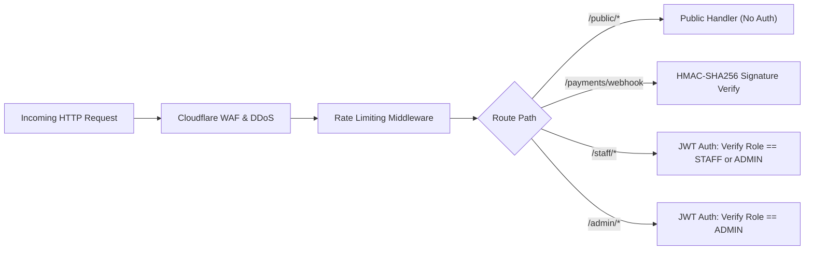

# เอกสารการออกแบบ API: ระบบจองรถของเล่น (API Design Specification)
## แพลตฟอร์ม: Cloudflare Workers (Hono Framework) & Cloudflare D1

> **มาตรฐานอ้างอิง:** Skill `05-api-design`  
> **อ้างอิงเอกสารก่อนหน้า:**  
> - Requirements: [`docs/requirements-toy-car-booking.md`](file:///c:/เสรี/docs/requirements-toy-car-booking.md)  
> - System Design: [`docs/system-design-toy-car-booking.md`](file:///c:/เสรี/docs/system-design-toy-car-booking.md)  
> - Database Design: [`docs/database-design-toy-car-booking.md`](file:///c:/เสรี/docs/database-design-toy-car-booking.md)  
> **Base URL:** `https://api.toycar-rent.com/api/v1`  
> **โปรโตคอล & สไตล์:** RESTful JSON API (RFC 9457 Problem Details)

---

## 1. กลยุทธ์การกำหนดเวอร์ชันและการตั้งชื่อ (Versioning & Resource Naming)

### 1.1 นโยบาย Versioning
* **URI Path Versioning:** กำหนด `/api/v1/` ใน Path URL สำหรับการเปลี่ยนแปลงโครงสร้างหลัก (Breaking Changes)
* **Backwards Compatibility:** หากมีการเพิ่มฟิลด์ใหม่ที่เป็น Optional หรือเพิ่ม Query Parameter จะคงไว้ที่ `/v1` โดยไม่ตัดฟิลด์เดิมทิ้ง

### 1.2 กฎการตั้งชื่อ Resource (RESTful Standards)
* ใช้ **คำนามพหูพจน์ (Plural Nouns)** ตัวพิมพ์เล็ก คั่นด้วย Hyphen (kebab-case): เช่น `/vehicles`, `/bookings`, `/rental-sessions`
* ใช้ **HTTP Verbs** ในการบอกการกระทำ (ห้ามใส่ Action ใน Path เช่น ห้ามใช้ `/getVehicles` หรือ `/deleteBooking`)
* สำหรับการดำเนินการทางธุรกิจที่ไม่ได้เป็น CRUD ตรงไปตรงมา (Sub-resource Actions) ให้ใช้รูปแบบ Sub-path เช่น:
  * `/bookings/hold` (การกักสิทธิ์ชั่วคราว)
  * `/rental-sessions/checkin` (การเริ่มปล่อยรถ)
  * `/rental-sessions/:id/checkout-preview` (การคำนวณค่าปรับล่วงหน้า)

---

## 2. สรุปรายการ Endpoint (Endpoint Catalog)

| Method | Endpoint Path | สิทธิ์การเข้าถึง (Auth) | คำอธิบายการทำงาน |
|---|---|---|---|
| `GET` | `/vehicles` | Public | ดึงรายการรถของเล่นทั้งหมด พร้อมฟิลเตอร์ตามสถานะและประเภท |
| `GET` | `/vehicles/:id/slots` | Public | ตรวจสอบรอบเวลาที่ว่างของรถคันที่ระบุในวันที่ต้องการ |
| `POST` | `/bookings/hold` | Public | กักสิทธิ์จองรถชั่วคราว 5 นาที และสร้าง QR PromptPay |
| `GET` | `/bookings/:bookingCode` | Public (Token/Code) | ตรวจสอบสถานะการจองและดึง QR Ticket |
| `POST` | `/payments/webhook` | Webhook Signature | รับ Callback แจ้งเตือนการชำระเงินสำเร็จจาก Payment Gateway |
| `POST` | `/rental-sessions/checkin` | `ROLE_STAFF` | สแกน QR Ticket ส่งมอบรถ และเริ่มจับเวลา Server Authoritative Timer |
| `POST` | `/rental-sessions/:id/checkout-preview` | `ROLE_STAFF` | คำนวณค่าปรับ Overtime และยอดคืนมัดจำสุทธิล่วงหน้า |
| `POST` | `/rental-sessions/:id/complete` | `ROLE_STAFF` | ยืนยันการตรวจรับรถ ปิดรอบการเช่า และบันทึกคืนเงินมัดจำ |
| `POST` | `/fleet/battery-cycles` | `ROLE_STAFF` | บันทึกการส่งรถเข้าชาร์จแบตเตอรี่ หรือยืนยันชาร์จเต็ม |
| `GET` | `/admin/metrics/daily` | `ROLE_ADMIN` | ดูรายงานรายได้ สถิติการใช้งาน และจำนวนรอบการเล่นประจำวัน |

---

## 3. รูปแบบข้อมูล Request / Response และ Schema ตัวอย่าง

### 3.1 การกักสิทธิ์จองรอบเวลา (Hold Slot)
* **Endpoint:** `POST /api/v1/bookings/hold`
* **Headers:**
  * `Content-Type: application/json`
  * `Idempotency-Key: 7b34b7f9-2b0e-436f-9815-56fa0840b21a` (ป้องกันการกดเบิ้ล)

#### Request Payload:
```json
{
  "vehicle_id": "01J8Y4GXYZ0000000000000001",
  "customer_name": "สมชาย รักลูก",
  "customer_phone": "0812345678",
  "slot_date": "2026-09-30",
  "slot_start_time": "14:00",
  "duration_minutes": 30
}
```

#### Response Payload (201 Created):
```json
{
  "success": true,
  "data": {
    "booking_id": "01J8Y4GXYZ0000000000000099",
    "booking_code": "BK-20260930-0842",
    "status": "HOLD",
    "hold_expires_at": "2026-09-30T07:05:00.000Z",
    "pricing": {
      "rent_amount_cents": 15000,
      "deposit_amount_cents": 10000,
      "total_amount_cents": 25000,
      "currency": "THB"
    },
    "payment": {
      "method": "PROMPTPAY",
      "qr_raw_data": "00020101021229370016A000000677010111...",
      "qr_image_url": "https://api.toycar-rent.com/api/v1/payments/qr/BK-20260930-0842.png"
    }
  }
}
```

---

### 3.2 การ Check-in ปล่อยรถหน้าร้าน (Staff Check-in)
* **Endpoint:** `POST /api/v1/rental-sessions/checkin`
* **Headers:**
  * `Authorization: Bearer <jwt_staff_token>`

#### Request Payload:
```json
{
  "booking_code": "BK-20260930-0842",
  "condition_before": "ตัวถังปกติ ไม่มีรอยแตก รีโมทพร้อมใช้งาน",
  "condition_photo_keys": [
    "inspections/20260930/BK0842_front.jpg"
  ]
}
```

#### Response Payload (200 OK):
```json
{
  "success": true,
  "data": {
    "session_id": "01J8Y5ABCD0000000000000123",
    "booking_code": "BK-20260930-0842",
    "vehicle_code": "CAR-03",
    "status": "ACTIVE",
    "timer": {
      "start_time": "2026-09-30T14:02:10.000Z",
      "scheduled_end_time": "2026-09-30T14:32:10.000Z",
      "duration_seconds": 1800,
      "alert_scheduled_at": "2026-09-30T14:27:10.000Z"
    }
  }
}
```

---

### 3.3 การคำนวณ Check-out ล่วงหน้า (Preview Settlement)
* **Endpoint:** `POST /api/v1/rental-sessions/:id/checkout-preview`

#### Response Payload (200 OK):
```json
{
  "success": true,
  "data": {
    "session_id": "01J8Y5ABCD0000000000000123",
    "start_time": "2026-09-30T14:02:10.000Z",
    "scheduled_end_time": "2026-09-30T14:32:10.000Z",
    "current_time": "2026-09-30T14:44:10.000Z",
    "elapsed_minutes": 42,
    "duration_minutes": 30,
    "overtime_raw_minutes": 12,
    "grace_period_minutes": 5,
    "billable_overtime_minutes": 7,
    "settlement": {
      "original_deposit_cents": 10000,
      "penalty_rate_per_min_cents": 1000,
      "penalty_cents": 7000,
      "damage_fee_cents": 0,
      "net_deposit_refund_cents": 3000,
      "additional_payment_required_cents": 0
    }
  }
}
```

---

## 4. มาตรฐานการจัดการข้อผิดพลาด (RFC 9457 Error Contract)

API ตอบกลับ Error ในรูปแบบสากล RFC 9457 (Problem Details for HTTP APIs):

```json
{
  "type": "https://api.toycar-rent.com/errors/slot-already-reserved",
  "title": "Conflict",
  "status": 409,
  "code": "SLOT_ALREADY_RESERVED",
  "detail": "รถคันนี้ในช่วงเวลา 14:00 - 14:30 ถูกจองไปแล้ว กรุณาเลือกรอบเวลาอื่น",
  "instance": "/api/v1/bookings/hold",
  "invalid_params": [
    {
      "name": "slot_start_time",
      "reason": "Overlaps with active booking 'BK-20260930-0771'"
    }
  ],
  "timestamp": "2026-09-29T19:10:00.000Z"
}
```

### ตารางรหัสข้อผิดพลาดหลัก (Application Error Codes):
| HTTP Status | Error Code | ความหมาย |
|---|---|---|
| `400 Bad Request` | `VALIDATION_ERROR` | ข้อมูลนำเข้าไม่ถูกต้องตาม Zod Schema |
| `401 Unauthorized`| `UNAUTHORIZED` | ไม่พบบัตรผ่าน Token หรือ Token หมดอายุ |
| `403 Forbidden`   | `FORBIDDEN_ROLE` | สิทธิ์ไม่เพียงพอ (เช่น ไม่ใช่ Staff) |
| `404 Not Found`   | `RESOURCE_NOT_FOUND` | ไม่พบรหัสรถ หรือรหัสการจองในระบบ |
| `409 Conflict`    | `SLOT_ALREADY_RESERVED` | รอบเวลารถถูกเลือกไปแล้ว (Race condition) |
| `422 Unprocessable`| `BATTERY_DEPLETED` | รถคันนี้ครบ 3 รอบ ต้องชาร์จแบตเตอรี่ก่อน |
| `429 Too Many Req`| `RATE_LIMIT_EXCEEDED` | เรียก API ถี่เกินกำหนดที่อนุญาต |

---

## 5. กฎการตรวจสอบความถูกต้องของข้อมูล (Input Validation Rules via Zod)

ใช้ **Zod** ร่วมกับ Hono ในการ Validate ข้อมูล Request:

```typescript
import { z } from 'zod';

// กฎสำหรับ Hold Slot Booking
export const HoldSlotSchema = z.object({
  vehicle_id: z.string().min(1, 'ต้องระบุ vehicle_id'),
  customer_name: z.string().trim().min(2, 'ชื่อต้องมีอย่างน้อย 2 ตัวอักษร').max(100),
  customer_phone: z.string().regex(/^0[689]\d{8}$/, 'เบอร์โทรศัพท์ต้องเป็นเบอร์มือถือไทย 10 หลัก (เช่น 0812345678)'),
  slot_date: z.string().regex(/^\d{4}-\d{2}-\d{2}$/, 'รูปแบบวันที่ต้องเป็น YYYY-MM-DD'),
  slot_start_time: z.string().regex(/^([01]\d|2[0-3]):[0-5]\d$/, 'รูปแบบเวลาต้องเป็น HH:MM (24 ชั่วโมง)'),
  duration_minutes: z.union([z.literal(15), z.literal(30), z.literal(60)], {
    errorMap: () => ({ message: 'ระยะเวลาต้องเป็น 15, 30 หรือ 60 นาทีเท่านั้น' })
  })
});
```

---

## 6. Authentication, Authorization & Security



1. **Staff & Admin (JWT Authentication):**
   * Header: `Authorization: Bearer <token>`
   * Payload: `{ "sub": "staff_123", "role": "STAFF", "branch_id": "BKK-01", "exp": 1727654400 }`
   * ตรวจสอบด้วย Secret Key ที่เข้ารหัสผ่าน Cloudflare Worker Secrets
2. **Payment Gateway Webhook Security:**
   * ตรวจสอบ Header `X-Signature` ด้วย HMAC-SHA256 Secret ป้องกันการยิง Webhook ปลอม
   * รองรับ Idempotency: หากได้รับ `transaction_id` เดิม จะไม่บันทึกซ้ำ

---

## 7. กลยุทธ์การจำกัดอัตราการเรียกใช้งาน (Rate Limiting)

ทำงานบน Cloudflare Edge โดยตรงผ่าน **Cloudflare Rate Limiting Rules** หรือ **Workers KV Rate Limiter**:

| กลุ่ม Endpoint | เกณฑ์ Rate Limit | ปฏิกิริยาเมื่อเกิน (Response) |
|---|---|---|
| `POST /bookings/hold` | **5 requests / นาที** ต่อ IP | `429 Too Many Requests` (ป้องกันบอตสแปมกักรอบเวลา) |
| `GET /vehicles/*` (Catalog) | **60 requests / นาที** ต่อ IP | `429 Too Many Requests` |
| `POST /payments/webhook` | **100 requests / นาที** (Whitelisted IPs) | จัดคิวเข้า Cloudflare Queue |
| `/rental-sessions/*` (Staff) | **120 requests / นาที** ต่อ Staff Token | `429 Too Many Requests` |

* **Headers ที่ส่งกลับเสมอ:**
  * `RateLimit-Limit: 60`
  * `RateLimit-Remaining: 42`
  * `RateLimit-Reset: 1727654460`

---

## 8. กลยุทธ์ป้องกันคำขอซ้ำซ้อน (Idempotency Mechanism)

สำหรับ Endpoint ที่มีการเปลี่ยนแปลงสถานะเงินหรือรอบเวลา (`POST /bookings/hold`, `POST /rental-sessions/checkin`):
* Client สามารถส่ง Header: `Idempotency-Key: <UUIDv4>`
* Backend ตรวจสอบใน **Cloudflare Workers KV** (TTL 15 นาที):
  * หากพบ Key และสถานะยัง `PROCESSING`: ตอบกลับ `409 In Progress`
  * หากพบ Key และมีผลลัพธ์แคชไว้แล้ว: ดึงผลลัพธ์ HTTP เดิมส่งกลับทันทีโดยไม่ประมวลผลซ้ำ
  * หากไม่พบ Key: บันทึก Key -> ประมวลผลธุรกรรม -> บันทึกผลลัพธ์ลงแคช

---

## 9. โครงสร้างเอกสาร OpenAPI 3.1 Outline

```yaml
openapi: 3.1.0
info:
  title: Toy Car Booking & Fleet Management API
  version: 1.0.0
  description: API บริการจองและบริหารจัดการรถของเล่นไฟฟ้าบน Cloudflare Workers
servers:
  - url: https://api.toycar-rent.com/api/v1
    description: Production Edge Server
paths:
  /vehicles:
    get:
      summary: ดึงรายการรถของเล่นทั้งหมด
      parameters:
        - name: category
          in: query
          schema:
            type: string
            enum: [SPORTS, JEEP, MOTORCYCLE, TRUCK]
        - name: status
          in: query
          schema:
            type: string
            enum: [AVAILABLE, IN_USE, CHARGING, MAINTENANCE]
      responses:
        '200':
          description: คืนรายการรถสำเร็จ
  /bookings/hold:
    post:
      summary: กักสิทธิ์จองรอบเวลา 5 นาที
      parameters:
        - name: Idempotency-Key
          in: header
          required: false
          schema:
            type: string
      requestBody:
        required: true
        content:
          application/json:
            schema:
              $ref: '#/components/schemas/HoldSlotRequest'
      responses:
        '201':
          description: กักสิทธิ์สำเร็จ
        '409':
          description: รอบเวลาถูกเลือกแล้ว (Conflict)
```

---

## 10. สรุปความพร้อมและขั้นตอนถัดไป (Next Steps)
การออกแบบ API นี้พร้อมสำหรับ:
1. **Implementation with Hono on Cloudflare Workers:** สามารถเริ่มเขียน Router, Middlewares, และ Zod Schema ได้ทันที
2. **`06-code-quality`**: ตรวจสอบคุณภาพโค้ด การจัดโครงสร้าง และ Type Safety เมื่อเริ่มเขียน Implementation Code
3. **`07-testing-qa`**: สร้าง API Integration Tests ชุดสมบูรณ์ (Testing with `vitest` and Cloudflare Miniflare/Workerd)
