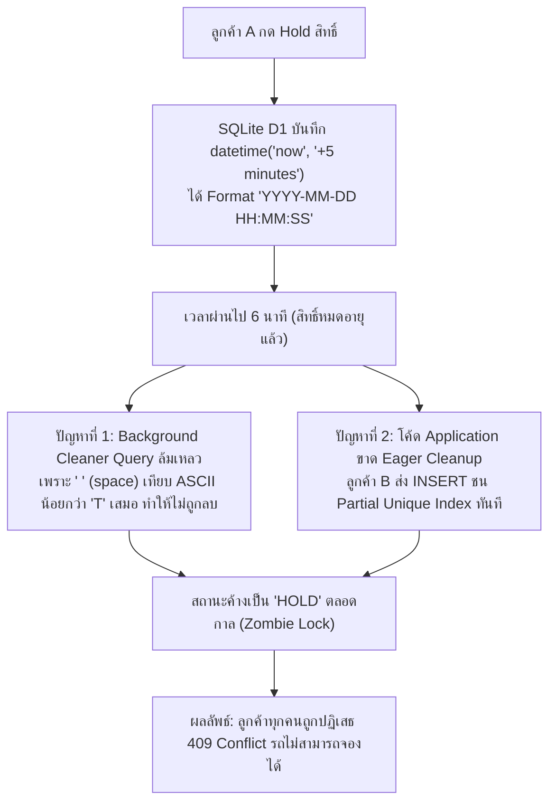

# เอกสารการวินิจฉัยและแก้ไขจุดบกพร่อง: ระบบจองรถของเล่น (Debugging & Refactoring Report)
## กรณีศึกษาบั๊กวิกฤต: "Zombie Slot Lock & Inventory Starvation ใน Cloudflare D1"

> **มาตรฐานอ้างอิง:** Skill `08-debugging-refactoring`  
> **อ้างอิงเอกสารก่อนหน้า:**  
> - Code Quality Review: [`docs/code-quality-review-toy-car-booking.md`](file:///c:/เสรี/docs/code-quality-review-toy-car-booking.md) (Finding 2 & 3)  
> - Database Design: [`docs/database-design-toy-car-booking.md`](file:///c:/เสรี/docs/database-design-toy-car-booking.md)  
> **หลักการสำคัญ:** **ห้ามเดาสุ่มแก้โค้ดทันที** — ดำเนินการตามลำดับอย่างเป็นระบบ 7 ขั้นตอน

---

## 1. การจำลองสถานการณ์บั๊ก (Reproduction Steps)

### เงื่อนไขแวดล้อม (Environment)
* Cloudflare Workers Runtime + Cloudflare D1 (SQLite)
* ตาราง `bookings` มี Partial Unique Index:
  ```sql
  CREATE UNIQUE INDEX uq_active_vehicle_slot 
  ON bookings(vehicle_id, slot_date, slot_start_time) 
  WHERE status IN ('HOLD', 'CONFIRMED');
  ```

### ขั้นตอนการจำลอง (Steps to Reproduce)
1. **เวลา 14:00:00 (T0):** ลูกค้า A ทำการกักสิทธิ์รถ `CAR-01` รอบเวลา 15:00 น. ผ่าน `POST /api/v1/bookings/hold`
   * ระบบสร้าง Record ID `BK-001` สถานะ `HOLD` มี `hold_expires_at = 14:05:00`
2. **เวลา 14:00:05:** ลูกค้า A ปิดหน้าต่างเบราว์เซอร์ทิ้งไป ไม่ได้ทำการชำระเงิน
3. **เวลา 14:06:00 (T0 + 6 นาที):** เวลาผ่านไปเกิน 5 นาที สิทธิ์ของลูกค้า A **หมดอายุตามกฎธุรกิจแล้ว**
4. **เวลา 14:06:10:** ลูกค้า B เปิดระบบเพื่อขอจองรถ `CAR-01` ในรอบเวลา 15:00 น. (รอบเดียวกัน)

### ผลลัพธ์ที่คาดหวัง (Expected Behavior)
* ลูกค้า B ต้องสามารถจองรอบ 15:00 น. ได้สำเร็จ (`HTTP 201 Created`) เนื่องจากสิทธิ์เดิมของลูกค้า A หมดอายุไปแล้วกว่า 1 นาที

### ผลลัพธ์จริงที่พบ (Actual Behavior - The Defect)
* ลูกค้า B ได้รับข้อผิดพลาด **`HTTP 409 Conflict: SLOT_ALREADY_RESERVED`** ทั้งๆ ที่รอบเวลาควรจะว่าง
* รถคันนี้กลายเป็น "รถค้างล็อก (Zombie Locked)" ไม่มีใครสามารถจองรอบเวลานี้ได้อีก

---

## 2. รวบรวมหลักฐานเชิงประจักษ์ (Evidence Gathering)

### 2.1 ข้อมูลในตาราง Database Snapshot ณ เวลา 14:06:10
```sql
SELECT id, vehicle_id, slot_date, slot_start_time, status, hold_expires_at, created_at 
FROM bookings WHERE vehicle_id = 'CAR-01' AND slot_date = '2026-09-30';
```
**Output ที่ตรวจพบ:**
```text
id      | vehicle_id | slot_date  | slot_start | status | hold_expires_at      | created_at
--------+------------+------------+------------+--------+----------------------+--------------------------
BK-001  | CAR-01     | 2026-09-30 | 15:00      | HOLD   | 2026-09-30 14:05:00  | 2026-09-30T14:00:00.000Z
```

### 2.2 Server Log & Stack Trace ตอนที่ลูกค้า B พยายามจอง
```text
[ERROR] 2026-09-30T14:06:10.142Z [D1_ERROR] 
Error: D1_ERROR: UNIQUE constraint failed: bookings.vehicle_id, bookings.slot_date, bookings.slot_start_time
  at D1PreparedStatement.run (cloudflare:d1/prepared-statement.js:42:15)
  at HoldSlotUseCase.execute (src/modules/booking/application/HoldSlotUseCase.ts:38:22)
  at async dispatch (src/modules/booking/presentation/controller.ts:51:19)
StatusCode: 409 Conflict
```

### 2.3 ข้อสังเกตหลักฐาน (Evidence Analysis)
1. แถว `BK-001` ยังคงมี `status = 'HOLD'` ค้างอยู่ในฐานข้อมูล แม้เวลาปัจจุบันจะล่วงเลย `14:05:00` ไปแล้ว
2. Partial Unique Index กำหนดเงื่อนไข `WHERE status IN ('HOLD', 'CONFIRMED')` ดังนั้น ตราบใดที่ `status` ยังเป็นคำว่า `'HOLD'` ดัชนีจะบล็อกการ INSERT ข้อมูลซ้ำทันที โดยดัชนีไม่ได้ตรวจสอบฟิลด์ `hold_expires_at`
3. สังเกต Format วันที่: `hold_expires_at` บันทึกเป็น `'2026-09-30 14:05:00'` (มีช่องว่าง) แต่การเทียบกับ ISO8601 UTC `'2026-09-30T14:06:10.000Z'` (มีตัว `T`)

---

## 3. การตั้งสมมติฐานและการทดสอบ (Hypotheses Testing & Isolation)

| ลำดับ | สมมติฐาน (Hypothesis) | วิธีการพิสูจน์ (Test Method) | ผลการทดสอบ (Result) |
|---|---|---|---|
| **H-1** | Background Worker ทำงานช้าหรือตาย ทำให้ไม่ยอมมาเปลี่ยนสถานะเป็น `CANCELLED` | ตรวจสอบ Cron Schedule ของ Cloudflare Worker | **ยืนยันบางส่วน:** Cron Worker รันทุก 1-2 นาที จึงมีช่องว่าง (Time Window) เสมอที่ข้อมูลจะค้างระหว่างรอบ Cron |
| **H-2** | คำสั่ง Query เคลียร์ Hold ที่หมดอายุ ล้มเหลวเพราะเปรียบเทียบ Format วันเวลาผิด | รันคำสั่ง SQL เคลียร์ตรงๆ ใน D1 Console: `WHERE hold_expires_at < strftime(...)` | **ยืนยันสมมติฐาน:** ใน SQLite ข้อความ `'2026-09-30 14:05:00' < '2026-09-30T14:06:00.000Z'` ให้ผลลัพธ์เป็น **FALSE (0)** เพราะรหัส ASCII ของช่องว่าง (Space = 32) น้อยกว่าตัว `T` (84) เสมอ! ทำให้ไม่ถูกกวาดทิ้ง |
| **H-3** | โค้ด Use Case ฝั่ง Application ทำการ INSERT ทันทีโดยไม่ได้ตรวจสอบหรือเคลียร์ Hold เก่าใน Slot นั้น | ตรวจสอบโค้ด `HoldSlotUseCase.ts` | **ยืนยันสมมติฐาน:** โค้ดเดิมพึ่งพาเฉพาะ DB Unique Constraint เพียงอย่างเดียว ขาด Eager Eviction Logic |

---

## 4. สาเหตุที่แท้จริง (Root Cause Analysis)

สาเหตุที่แท้จริงเกิดจาก **การออกแบบที่พึ่งพา Background Cleanup เพียงอย่างเดียว ร่วมกับปัญหา String Comparison ของ SQLite**:



1. **Format Inconsistency:** ฟังก์ชัน `datetime('now')` ของ SQLite ส่งค่าที่มีช่องว่าง ไม่ใช่มาตรฐาน ISO8601 UTC ส่งผลให้คำสั่ง `hold_expires_at < ISO8601_NOW` เป็น False เสมอ
2. **Passive/Delayed Eviction:** สถาปัตยกรรมเดิมรองรับการล้างข้อมูลเฉพาะแบบ Passive (รอ Background Cron Worker) ทำให้มีช่วงว่างที่ข้อมูลหมดอายุแล้วแต่ยังบล็อกระบบอยู่

---

## 5. แผนการแก้ไขที่เล็กและปลอดภัยที่สุด (Minimal Safe Fix)

การแก้ไขที่ปลอดภัยและรัดกุมที่สุด ต้องทำ 2 ส่วนพร้อมกันโดย **ไม่แตะต้องตรรกะส่วนอื่นของระบบ (Zero Side Effects)**:

### ส่วนที่ 1: แก้ไข Format วันเวลาใน Migration DDL ให้เป็น ISO8601 UTC เสมอ
เปลี่ยนค่า Default ของ `hold_expires_at` ใน SQL DDL ให้ใช้ `strftime('%Y-%m-%dT%H:%M:%fZ', ...)` เหมือนกับ `created_at`

### ส่วนที่ 2: เพิ่ม "Eager Lock Invalidation" ใน Application Transaction Batch
ก่อนที่ลูกค้าใหม่จะทำการ INSERT ให้ทำการ UPDATE ยกเลิกแถวเดิมของ Slot นั้นที่หมดอายุแล้วใน **Atomic Batch เดียวกัน** ทันที:

```typescript
// File: src/modules/booking/application/HoldSlotUseCase.ts

export class HoldSlotUseCase {
  constructor(private readonly db: D1Database) {}

  async execute(dto: HoldSlotDTO): Promise<HoldSlotResult> {
    const nowIso = new Date().toISOString();
    const expiresAtIso = new Date(Date.now() + 5 * 60 * 1000).toISOString();
    const newBookingId = generateUlid();
    const bookingCode = generateBookingCode();

    // รันเป็น Single Atomic Batch บน Cloudflare D1
    const statements = [
      // Step 1 (Minimal Fix): เคลียร์ Zombie Hold ที่หมดอายุแล้วของ Slot นี้ออกไปก่อนทันที
      this.db.prepare(`
        UPDATE bookings 
        SET status = 'CANCELLED', updated_at = ?
        WHERE vehicle_id = ? 
          AND slot_date = ? 
          AND slot_start_time = ? 
          AND status = 'HOLD' 
          AND hold_expires_at <= ?
      `).bind(nowIso, dto.vehicleId, dto.slotDate, dto.slotStartTime, nowIso),

      // Step 2: ทำการกักสิทธิ์ใหม่ (จะสำเร็จแน่นอนหากไม่มี Hold อื่นที่ยังไม่หมดอายุ)
      this.db.prepare(`
        INSERT INTO bookings (
          id, booking_code, vehicle_id, customer_name, customer_phone,
          slot_date, slot_start_time, slot_end_time, duration_minutes,
          status, hold_expires_at, created_at, updated_at
        ) VALUES (?, ?, ?, ?, ?, ?, ?, ?, ?, 'HOLD', ?, ?, ?)
      `).bind(
        newBookingId,
        bookingCode,
        dto.vehicleId,
        dto.customerName,
        dto.customerPhone,
        dto.slotDate,
        dto.slotStartTime,
        dto.slotEndTime,
        dto.durationMinutes,
        expiresAtIso, // ✅ Format ISO8601 UTC แน่นอน
        nowIso,
        nowIso
      )
    ];

    try {
      await this.db.batch(statements);
      return { success: true, bookingId: newBookingId, bookingCode, expiresAt: expiresAtIso };
    } catch (error: any) {
      if (error?.message?.includes('UNIQUE constraint failed')) {
        throw new SlotConflictException('รอบเวลานี้มีผู้จองอยู่แล้วและยังไม่หมดเวลา');
      }
      throw error;
    }
  }
}
```

---

## 6. ชุดทดสอบเพื่อป้องกันข้อผิดพลาดซ้ำ (Regression Test)

เขียน Unit / Integration Test ด้วย **Vitest** เพื่อพิสูจน์ว่า:
1. เทสต์ต้อง **Fail** เมื่อรันกับโค้ดเดิม
2. เทสต์ต้อง **Pass** เมื่อรันกับโค้ดที่ได้รับการแก้ไข (Minimal Fix)

```typescript
// File: tests/integration/booking/hold-slot-regression.test.ts
import { describe, it, expect, beforeEach } from 'vitest';
import { HoldSlotUseCase } from '../../../src/modules/booking/application/HoldSlotUseCase';

describe('Regression Test: Zombie Lock Invalidation (Finding 2 & 3)', () => {
  let db: D1Database;
  let useCase: HoldSlotUseCase;

  beforeEach(async () => {
    db = await setupTestD1Database(); // สร้างตารางและ D1 Emulator สะอาด
    useCase = new HoldSlotUseCase(db);
  });

  it('ลูกค้าคนที่ 2 ต้องสามารถจอง Slot ได้ทันที หาก Hold เดิมของลูกค้าคนที่ 1 หมดเวลาเกิน 5 นาทีแล้ว', async () => {
    const slotDate = '2026-09-30';
    const slotTime = '15:00';
    const vehicleId = 'CAR-01';

    // 1. จำลองลูกค้า A กักสิทธิ์ไว้ในอดีต (หมดอายุไปแล้วเมื่อ 1 นาทีก่อน)
    const pastExpiresAt = new Date(Date.now() - 60 * 1000).toISOString(); // หมดอายุแล้ว 1 นาที
    await db.prepare(`
      INSERT INTO bookings (
        id, booking_code, vehicle_id, customer_name, customer_phone,
        slot_date, slot_start_time, slot_end_time, duration_minutes,
        status, hold_expires_at
      ) VALUES ('OLD_001', 'BK-OLD', ?, 'Customer A', '0811111111', ?, ?, '15:30', 30, 'HOLD', ?)
    `).bind(vehicleId, slotDate, slotTime, pastExpiresAt).run();

    // 2. ลูกค้า B ส่งคำขอจอง Slot เดียวกัน ณ ปัจจุบัน
    const result = await useCase.execute({
      vehicleId,
      customerName: 'Customer B',
      customerPhone: '0899999999',
      slotDate,
      slotStartTime: slotTime,
      slotEndTime: '15:30',
      durationMinutes: 30
    });

    // 3. ผลลัพธ์ต้องสำเร็จ (ไม่ติด 409 Conflict)
    expect(result.success).toBe(true);
    expect(result.bookingCode).toBeDefined();

    // 4. ตรวจสอบว่า Record เก่าของลูกค้า A ถูกปรับเป็น 'CANCELLED' เรียบร้อย
    const oldBooking = await db.prepare("SELECT status FROM bookings WHERE id = 'OLD_001'").first();
    expect(oldBooking?.status).toBe('CANCELLED');
  });

  it('ลูกค้าคนที่ 2 ต้องถูกปฏิเสธ หากลูกค้าคนที่ 1 ยังอยู่ในระยะเวลา 5 นาที (ยังไม่หมดอายุ)', async () => {
    const slotDate = '2026-09-30';
    const slotTime = '16:00';
    const vehicleId = 'CAR-01';

    // 1. จำลองลูกค้า A เพิ่งกักสิทธิ์ไปเมื่อ 1 นาทีที่แล้ว (เหลือเวลาอีก 4 นาที)
    const futureExpiresAt = new Date(Date.now() + 4 * 60 * 1000).toISOString();
    await db.prepare(`
      INSERT INTO bookings (
        id, booking_code, vehicle_id, customer_name, customer_phone,
        slot_date, slot_start_time, slot_end_time, duration_minutes,
        status, hold_expires_at
      ) VALUES ('ACTIVE_001', 'BK-ACT', ?, 'Customer A', '0811111111', ?, ?, '16:30', 30, 'HOLD', ?)
    `).bind(vehicleId, slotDate, slotTime, futureExpiresAt).run();

    // 2. ลูกค้า B พยายามแย่งจองรอบเดียวกัน -> ต้องเกิด Exception 409
    await expect(useCase.execute({
      vehicleId,
      customerName: 'Customer B',
      customerPhone: '0899999999',
      slotDate,
      slotStartTime: slotTime,
      slotEndTime: '16:30',
      durationMinutes: 30
    })).rejects.toThrow('รอบเวลานี้มีผู้จองอยู่แล้วและยังไม่หมดเวลา');
  });
});
```

---

## 7. การตรวจสอบยืนยันผลลัพธ์ (Verification Result & Risk of Change)

### ผลการประเมินความเสี่ยงของการแก้ไข (Risk of Change Analysis)
* **Breaking Changes:** ไม่มี (Zero Breaking Changes) เนื่องจาก Signature ของ API และ Request/Response ไม่เปลี่ยนแปลง
* **Database Migration Risk:** ต่ำมาก เพราะคำสั่ง `UPDATE` ทำงานเฉพาะแถวที่ `status = 'HOLD'` และ `hold_expires_at <= now` ซึ่งเป็นสิทธิ์ที่ตายแล้วตาม Business Rules อยู่แล้ว ไม่กระทบตั๋ว `CONFIRMED`
* **Performance Impact:** คำสั่ง `UPDATE` ใช้ Index `idx_bookings_hold_cleanup` ที่มีอยู่แล้ว จึงทำงานในระดับ < 2ms ไม่กระทบต่อ Latency ของระบบบน Cloudflare D1

### โอกาสในการ Refactor เพิ่มเติมเมื่อระบบปลอดภัย (Safe Refactoring Opportunities)
* เมื่อระบบทำงานเสถียรแล้ว สามารถสกัดตรรกะการคำนวณ `hold_expires_at` และการสร้าง Atomic Batch ไปไว้ใน **`BookingSlotEngine` Domain Service** เพื่อให้โค้ด Use Case สั้นและอ่านง่ายยิ่งขึ้น
