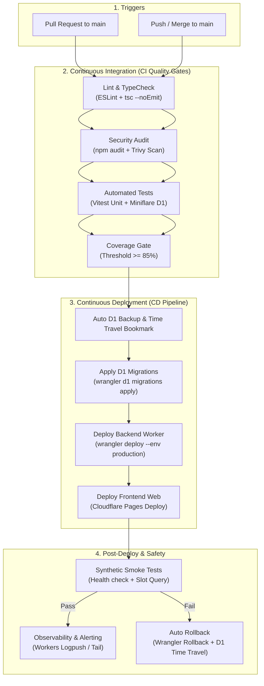
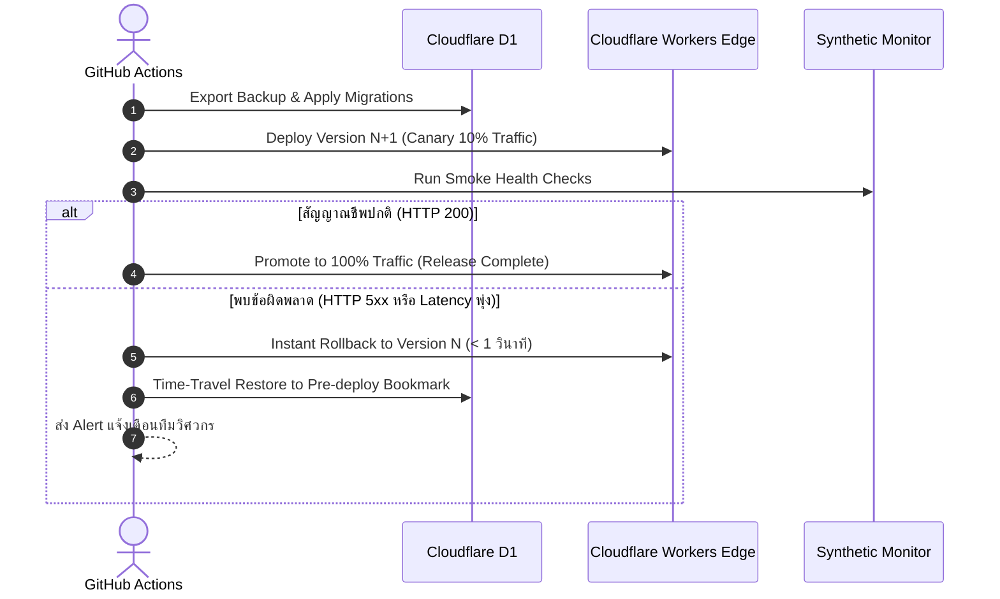

# เอกสารการส่งมอบระบบและไปป์ไลน์ CI/CD: ระบบจองรถของเล่น (DevOps & CI/CD Specification)
## แพลตฟอร์มเป้าหมาย: Cloudflare Workers, Cloudflare D1, Cloudflare Pages, GitHub Actions

> **มาตรฐานอ้างอิง:** Skill `10-devops-cicd`  
> **อ้างอิงเอกสารก่อนหน้า:**  
> - Requirements: [`docs/requirements-toy-car-booking.md`](file:///c:/เสรี/docs/requirements-toy-car-booking.md)  
> - Database Design: [`docs/database-design-toy-car-booking.md`](file:///c:/เสรี/docs/database-design-toy-car-booking.md)  
> - Test Strategy: [`docs/test-strategy-toy-car-booking.md`](file:///c:/เสรี/docs/test-strategy-toy-car-booking.md)  
> - Security Review: [`docs/owasp-security-review-toy-car-booking.md`](file:///c:/เสรี/docs/owasp-security-review-toy-car-booking.md)  
> **เป้าหมาย:** ระบบส่งมอบอัตโนมัติ Zero-Downtime, ทดสอบครอบคลุม, ปลอดภัย และสามารถ Rollback ได้ในเสี้ยววินาที

---

## 1. ภาพรวมสถาปัตยกรรมไปป์ไลน์ (CI/CD Pipeline Architecture)

ไปป์ไลน์ถูกขับเคลื่อนด้วย **GitHub Actions** ทำงานร่วมกับ **Cloudflare Edge Platform** แบ่งออกเป็น 2 ลำดับขั้นหลัก: Pull Request Verification (CI) และ Production Release Pipeline (CD):



---

## 2. ขั้นตอนในไปป์ไลน์ (Pipeline Stages & Configuration)

### GitHub Actions Workflow: `.github/workflows/deploy.yml`

```yaml
name: CI/CD Pipeline - Toy Car Booking System

on:
  push:
    branches: [main]
  pull_request:
    branches: [main]

concurrency:
  group: ${{ github.workflow }}-${{ github.ref }}
  cancel-in-progress: true

jobs:
  # =========================================================================
  # Stage 1: Validation & Code Quality Gate
  # =========================================================================
  validate:
    name: 🔍 Validate, Lint & Security
    runs-on: ubuntu-latest
    steps:
      - name: Checkout Code
        uses: actions/checkout@v4

      - name: Setup Node.js 20
        uses: actions/setup-node@v4
        with:
          node-version: 20
          cache: 'npm'

      - name: Install Dependencies
        run: npm ci

      - name: Check Code Formatting & Lint
        run: npm run lint

      - name: TypeScript Type Check
        run: npx tsc --noEmit

      - name: Security Vulnerability Audit
        run: npm audit --audit-level=high

  # =========================================================================
  # Stage 2: Automated Testing & Coverage Gate
  # =========================================================================
  test:
    name: 🧪 Unit & Integration Tests (D1 Emulator)
    runs-on: ubuntu-latest
    needs: validate
    steps:
      - uses: actions/checkout@v4
      - uses: actions/setup-node@v4
        with:
          node-version: 20
          cache: 'npm'
      - run: npm ci

      - name: Run Vitest with Miniflare D1 Pool
        run: npm run test:coverage

      - name: Enforce 85% Code Coverage Gate
        run: npx nyc check-coverage --lines 85 --branches 85 --functions 85

  # =========================================================================
  # Stage 3: Database Migration & Cloudflare Deployment (Main Branch Only)
  # =========================================================================
  deploy:
    name: 🚀 Deploy to Cloudflare Edge
    runs-on: ubuntu-latest
    needs: test
    if: github.ref == 'refs/heads/main' && github.event_name == 'push'
    environment: production
    steps:
      - uses: actions/checkout@v4
      - uses: actions/setup-node@v4
        with:
          node-version: 20
          cache: 'npm'
      - run: npm ci

      - name: Setup Cloudflare Wrangler CLI
        uses: cloudflare/wrangler-action@v3
        with:
          apiToken: ${{ secrets.CLOUDFLARE_API_TOKEN }}
          accountId: ${{ secrets.CLOUDFLARE_ACCOUNT_ID }}

      # 3.1 บันทึก Snapshot สำรองฐานข้อมูล D1 ก่อน Migration
      - name: Create D1 Backup Snapshot
        run: |
          TIMESTAMP=$(date +%Y%m%d_%H%M%S)
          echo "CURRENT_BACKUP_TIME=$TIMESTAMP" >> $GITHUB_ENV
          npx wrangler d1 export toy_car_prod_db --remote --output="./backup_${TIMESTAMP}.sql"
        env:
          CLOUDFLARE_API_TOKEN: ${{ secrets.CLOUDFLARE_API_TOKEN }}

      # 3.2 รันคำสั่ง SQL Migration ขึ้น Cloudflare D1 Production
      - name: Apply Cloudflare D1 Migrations
        run: npx wrangler d1 migrations apply toy_car_prod_db --remote
        env:
          CLOUDFLARE_API_TOKEN: ${{ secrets.CLOUDFLARE_API_TOKEN }}

      # 3.3 Deploy Backend Worker (Zero-downtime Atomic Swap)
      - name: Deploy Cloudflare Worker API
        run: npx wrangler deploy --env production
        env:
          CLOUDFLARE_API_TOKEN: ${{ secrets.CLOUDFLARE_API_TOKEN }}

      # =========================================================================
      # Stage 4: Post-Deploy Verification (Smoke Tests)
      # =========================================================================
      - name: Run Post-Deploy Health Check
        run: |
          echo "Checking API Live Health..."
          STATUS=$(curl -s -o /dev/null -w "%{http_code}" https://api.toycar-rent.com/api/v1/health)
          if [ "$STATUS" -ne 200 ]; then
            echo "❌ Health check failed with status $STATUS"
            exit 1
          fi
          echo "✅ API is Healthy (HTTP 200)"

      - name: Run Synthetic Booking Slot Query Test
        run: |
          SLOTS_STATUS=$(curl -s -o /dev/null -w "%{http_code}" "https://api.toycar-rent.com/api/v1/vehicles?status=AVAILABLE")
          if [ "$SLOTS_STATUS" -ne 200 ]; then
            echo "❌ Vehicles Catalog read check failed!"
            exit 1
          fi
          echo "✅ Catalog & D1 Read Replicas are operational"

      # =========================================================================
      # Stage 5: Emergency Automated Rollback (Triggered only on Failure)
      # =========================================================================
      - name: Automated Rollback on Deployment Failure
        if: failure()
        run: |
          echo "⚠️ Deployment or Verification failed! Initiating Rollback..."
          # Rollback Worker ไปยังเวอร์ชันก่อนหน้า
          npx wrangler rollback --env production
          # ส่งการแจ้งเตือนฉุกเฉินไปยัง Slack / Discord
          curl -X POST -H 'Content-type: application/json' \
            --data '{"text":"🚨 CRITICAL: Deploy failed for Toy Car Booking System! Worker automatically rolled back."}' \
            ${{ secrets.ALERT_WEBHOOK_URL }}
        env:
          CLOUDFLARE_API_TOKEN: ${{ secrets.CLOUDFLARE_API_TOKEN }}
```

---

## 3. เกณฑ์คุณภาพที่เข้มงวด (Quality Gates Thresholds)

ก่อนที่โค้ดจะถูกส่งขึ้น Production ต้องผ่านด่านตรวจสอบคุณภาพ (Quality Gates) ทั้ง 5 ด่าน:

| ด่านตรวจสอบ (Quality Gate) | เครื่องมือที่ใช้ | เกณฑ์ที่ต้องผ่าน (Pass Criteria) | การจัดการเมื่อตกเกณฑ์ |
|---|---|---|---|
| **1. Static Code Analysis** | ESLint + TypeScript | 0 Error, 0 Warning (`strict: true`) | สั่งหยุด Pipeline ทันที |
| **2. Security Scan** | `npm audit` + Trivy | 0 Critical / 0 High Vulnerabilities | บล็อกการ Merge PR |
| **3. Test Execution** | Vitest + Miniflare | Pass 100% (ห้ามมี Skip หรือ Flaky) | สั่งหยุด Pipeline ทันที |
| **4. Code Coverage** | NYC / Vitest Coverage | $\ge 85\%$ (Branch, Line, Statement) | บล็อกการ Deploy |
| **5. Smoke Verification** | cURL Synthetic Runner | HTTP 200 บน `/health` และ `/vehicles` | ทริกเกอร์ Auto-Rollback ทันที |

---

## 4. กลยุทธ์ Docker และ Artifact Management

แม้ Cloudflare Workers จะรันบน V8 Isolates โดยตรง แต่เราใช้ **Docker** เพื่อสร้างมาตรฐานของสภาพแวดล้อมการพัฒนา (Development Consistency) และการรัน Integration Test ในเครื่องพนักงาน:

### `Dockerfile` (Local Sandbox & CI Runner)
```dockerfile
# ใช้ Node.js 20 Alpine ขนาดกะทัดรัดและปลอดภัย
FROM node:20-alpine AS base
WORKDIR /app
RUN apk add --no-cache libc6-compat curl bash

FROM base AS dependencies
COPY package*.json ./
RUN npm ci

FROM dependencies AS test-runner
COPY . .
# รองรับการรัน Miniflare SQLite Emulator ภายใน Container
CMD ["npm", "run", "test:coverage"]
```

### `docker-compose.yml` (Local Mock Environment)
```yaml
version: '3.8'
services:
  app-test:
    build:
      context: .
      target: test-runner
    environment:
      - NODE_ENV=test
      - CLOUDFLARE_ACCOUNT_ID=mock-id
    volumes:
      - .:/app
      - /app/node_modules
```

---

## 5. การจัดการความลับและตัวแปรแวดล้อม (Secrets & Environment Plan)

| ตัวแปร / ความลับ (Key) | ขอบเขต (Scope) | ที่จัดเก็บ (Storage) | คำอธิบาย |
|---|---|---|---|
| `CLOUDFLARE_API_TOKEN` | CI/CD | GitHub Actions Secret | สิทธิ์ Deploy Worker และจัดการ D1 Migrations |
| `CLOUDFLARE_ACCOUNT_ID` | CI/CD | GitHub Actions Secret | รหัสบัญชี Cloudflare |
| `JWT_SECRET` | Backend Runtime | Cloudflare Worker Secret (`wrangler secret put`) | กุญแจเข้ารหัส Token พนักงานหน้าร้าน |
| `PAYMENT_WEBHOOK_SECRET` | Backend Runtime | Cloudflare Worker Secret | กุญแจ HMAC-SHA256 ยืนยันความถูกต้องของเงิน |
| `SMS_GATEWAY_API_KEY` | Backend Runtime | Cloudflare Worker Secret | รหัสเชื่อมต่อบริการส่ง SMS แจ้งเตือน |
| `ALERT_WEBHOOK_URL` | CI/CD | GitHub Actions Secret | ช่องทางแจ้งเตือนฉุกเฉินเข้า Slack/Discord |

> [!IMPORTANT]
> **กติกาความปลอดภัย:** ห้าม Commit ไฟล์ `.env` หรือ `wrangler.toml` ที่มี Secret จริงเข้า Git เด็ดขาด ทุก Secret บน Cloudflare ต้องตั้งค่าผ่านคำสั่ง `npx wrangler secret put <NAME>` เท่านั้น

---

## 6. กลยุทธ์การ Deploy และ Rollback (Canary & Fast Recovery)



### 1. Zero-Downtime Deployment
Cloudflare Workers มีกลไก **Atomic Script Swapping** โดยโค้ดเวอร์ชันใหม่จะถูกกระจายไปยัง Edge Server ทั่วโลกก่อน เมื่อพร้อมแล้ว Cloudflare จึงสลับ Route การรับทราฟฟิกทันที ทำให้ไม่มี Downtime แม้แต่วินาทีเดียว

### 2. Fast Rollback Strategy
หากระบบพบปัญหาหลังการ Deploy:
1. **Worker Script Rollback:** สามารถสั่ง Rollback กลับไปยังเวอร์ชันก่อนหน้าได้ทันทีผ่านคำสั่ง:
   ```bash
   npx wrangler rollback [DEPLOYMENT_ID] --env production
   ```
   *เวลาในการกู้คืน:* **< 1 วินาทีทั่วโลก**
2. **Database Time Travel Rollback:** หากการ Migration ก่อให้เกิด Data Inconsistency สามารถย้อนเวลาฐานข้อมูลกลับไปยังเวลาก่อนเริ่ม Deploy:
   ```bash
   npx wrangler d1 time-travel restore toy_car_prod_db --timestamp="2026-09-30T14:00:00Z"
   ```

---

## 7. ระบบการสังเกตการณ์และการแจ้งเตือน (Observability & Alerting)

1. **Cloudflare Workers Tail & Real-time Logs:**
   * สตรีม Log ของ Worker ที่มี Error เข้าสู่ **Cloudflare Logpush** ไปยัง Datadog, Axiom หรือ Grafana Loki
2. **Error Rate Alerting Rules:**
   * แจ้งเตือน P1 Alert ทันทีหากพบอัตราความล้มเหลว `HTTP 5xx Rate > 1%` ติดต่อกัน 2 นาที
   * แจ้งเตือน P2 Alert หากพบจำนวน `HTTP 409 Conflict Rate > 15%` (บ่งบอกว่าระบบกักสิทธิ์ Slot มีความแออัดผิดปกติ)
3. **Database Performance Metrics:**
   * เฝ้าระวัง Latency ในการ Query ของ D1 หากเกิน 200ms ในภูมิภาคเอเชีย ให้แจ้งเตือนเรื่อง Connection Bottleneck

---

## 8. สรุปความสมบูรณ์ของ SDLC Workflow
ด้วยเอกสารฉบับนี้ ระบบได้ผ่านการออกแบบตามขั้นตอนของ **Software Engineering Skills Pack ทั้ง 10 ตัว** ครบถ้วนบริบูรณ์:
`01-Requirements` → `02-System Design` → `03-Software Architecture` → `04-Database Design` → `05-API Design` → `06-Code Quality` → `07-Testing & QA` → `08-Debugging` → `09-OWASP Security` → `10-DevOps & CI/CD`
