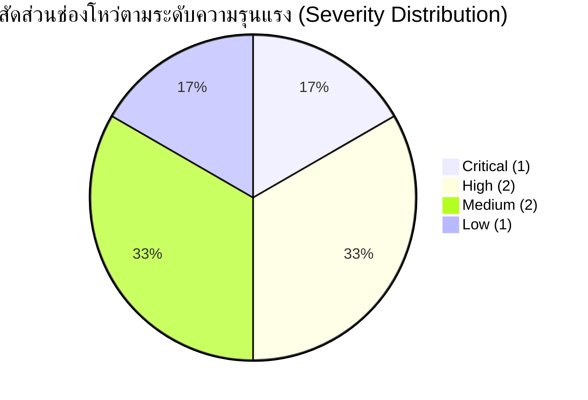

# รายงานการตรวจสอบความปลอดภัยของระบบ: ระบบจองรถของเล่น (OWASP Security Review)

> **มาตรฐานอ้างอิง:** Skill `09-owasp-security`  
> **มาตรฐานความปลอดภัย:** OWASP Top 10:2021 & OWASP API Security Top 10:2023  
> **เป้าหมายการตรวจ:** Architecture, Cloudflare D1 Database, REST API Contracts, และ Authentication Model  
> **เงื่อนไข:** **Review Only (ยังไม่มีการแก้ไขไฟล์โค้ดจริงในรอบนี้)**

---

## 1. บทสรุปผลการประเมินความปลอดภัย (Executive Security Summary)

จากการตรวจสอบพิมพ์เขียวสถาปัตยกรรม ฐานข้อมูล API และโมเดลการพิสูจน์ตัวตน พบข้อค้นพบด้านความปลอดภัย **6 ประเด็น** แบ่งตามระดับความรุนแรง (Severity) ดังนี้:
- 🔴 **Critical Severity:** 1 ประเด็น (การเข้าถึงข้อมูลตั๋วโดยไม่มีการตรวจสอบสิทธิ์ความเป็นเจ้าของ - BOLA/IDOR)
- 🟠 **High Severity:** 2 ประเด็น (Webhook Replay Attack และ Unrestricted File Upload ในรูปตรวจสภาพรถ)
- 🟡 **Medium Severity:** 2 ประเด็น (การจัดเก็บข้อมูลส่วนบุคคล PII โดยไม่ได้เข้ารหัส และการขาดกลไก Revoke Token พนักงาน)
- 🟢 **Low Severity:** 1 ประเด็น (การเปิดเผยรหัสการจองของบุคคลอื่นใน Error Message)

---

## 2. รายละเอียดข้อค้นพบด้านความปลอดภัย (Security Findings)

---

### Finding SEC-01: ช่องโหว่ Broken Object Level Authorization (BOLA/IDOR) ในการดึงข้อมูลตั๋ว
* **ระดับความรุนแรง (Severity):** 🔴 **Critical**
* **ตำแหน่ง (File / Function):** [`docs/api-design-toy-car-booking.md`](file:///c:/เสรี/docs/api-design-toy-car-booking.md) — Endpoint `GET /api/v1/bookings/:bookingCode`
* **มาตรฐาน OWASP:** 
  * **OWASP API Security Top 10:** `API1:2023 - Broken Object Level Authorization (BOLA)`
  * **OWASP Top 10:2021:** `A01:2021 - Broken Access Control`
* **หลักฐานเชิงประจักษ์ (Evidence):**
  ในเอกสาร API Endpoint `GET /bookings/:bookingCode` ถูกระบุสิทธิ์เป็น "Public (Token/Code)" โดยใช้รหัสการจองแบบเดาได้ง่าย เช่น `BK-20260930-0842` ซึ่งรหัสมีรูปแบบ `BK-[YYYYMMDD]-[ลำดับ 4 หลัก]`
* **ผลกระทบ (Impact):**
  ผู้ไม่หวังดีสามารถเขียนสคริปต์ยิงสุ่มรหัสลำดับตัวเลข 0001 - 9999 (Brute Force / Enumeration) เพื่อขโมยข้อมูลส่วนบุคคล (PII) ของลูกค้า เช่น ชื่อ-นามสกุลผู้ปกครอง เบอร์โทรศัพท์ ประวัติรอบเวลา หรือขโมย QR Code ไปสแกนตัดหน้ารับรถของเล่นไปขับฟรี
* **แนวทางการแก้ไข (Recommended Fix):**
  1. ใช้ **Opaque Capability Token (UUIDv4 หรือ Nanoid 128-bit)** เป็น Query Parameter สำหรับยืนยันความเป็นเจ้าของ เช่น `GET /bookings/:id?token=sec_7a8b9c...`
  2. เข้ารหัส QR Ticket ด้วย HMAC-SHA256 Secret ประจำเซิร์ฟเวอร์ โดยพนักงานต้องสแกนตั๋วที่มีลายเซ็นดิจิทัลเท่านั้น
* **การทดสอบยืนยัน (Verification):**
  ส่งคำขอ `GET /bookings/BK-20260930-0842` โดยไม่มี Secret Token ที่ถูกต้อง → ต้องได้รับคำตอบ `HTTP 401 Unauthorized` หรือ `404 Not Found`

---

### Finding SEC-02: ช่องโหว่ Webhook Replay Attack ขาดการตรวจสอบ Timestamp Tolerance
* **ระดับความรุนแรง (Severity):** 🟠 **High**
* **ตำแหน่ง (File / Function):** [`docs/api-design-toy-car-booking.md`](file:///c:/เสรี/docs/api-design-toy-car-booking.md) — Endpoint `POST /api/v1/payments/webhook`
* **มาตรฐาน OWASP:**
  * **OWASP API Security Top 10:** `API4:2023 - Unrestricted Resource Consumption`
  * **OWASP Top 10:2021:** `A08:2021 - Software and Data Integrity Failures`
* **หลักฐานเชิงประจักษ์ (Evidence):**
  การตรวจสอบ Signature ในเอกสารระบุเพียงการตรวจ HMAC-SHA256 จาก Request Body โดย **ไม่มีการตรวจสอบ Timestamp Header (`X-Signature-Timestamp`)**
* **ผลกระทบ (Impact):**
  หากผู้โจมตีสามารถดักจับ (Sniff) แพ็กเก็ต Webhook ที่ถูกต้องได้ ผู้โจมตีสามารถนำข้อมูลดิบพร้อม Signature เดิมมายิงซ้ำ (Replay Attack) ในเวลาอื่น ทำให้เกิด Race Condition หรือสับสนในระบบบัญชีเงินมัดจำ
* **แนวทางการแก้ไข (Recommended Fix):**
  1. บังคับให้ Webhook ต้องแนบ Header `X-Signature-Timestamp`
  2. นำ Timestamp มาต่อกับ Payload ก่อนคำนวณ HMAC: `HMAC_SHA256(secret, timestamp + "." + body)`
  3. ตรวจสอบว่า Timestamp ไม่ต่างจากเวลาปัจจุบันเกิน $\pm 5$ นาที (Clock Skew Tolerance)
* **การทดสอบยืนยัน (Verification):**
  ส่ง Webhook ที่ Signature ถูกต้อง แต่เวลา Timestamp เก่าเกิน 5 นาที → ต้องถูกปฏิเสธด้วย `400 Bad Request: Webhook timestamp expired`

---

### Finding SEC-03: การอัปโหลดรูปตรวจสภาพรถขาดการจำกัดสิทธิ์และ Path Traversal
* **ระดับความรุนแรง (Severity):** 🟠 **High**
* **ตำแหน่ง (File / Function):** [`docs/api-design-toy-car-booking.md`](file:///c:/เสรี/docs/api-design-toy-car-booking.md) — `condition_photo_keys` ใน `POST /api/v1/rental-sessions/checkin`
* **มาตรฐาน OWASP:**
  * **OWASP Top 10:2021:** `A03:2021 - Injection (Path Traversal)` & `A04:2021 - Insecure Design`
  * **OWASP API Security Top 10:** `API8:2023 - Security Misconfiguration`
* **หลักฐานเชิงประจักษ์ (Evidence):**
  API รับอาเรย์ข้อความ `condition_photo_keys` จาก Client โดยตรง เช่น `["inspections/20260930/BK0842_front.jpg"]` โดยไม่มีการตรวจเช็กประเภทไฟล์ ขนาดไฟล์ หรือการป้องกัน Path Traversal (`../`) บน Cloudflare R2
* **ผลกระทบ (Impact):**
  ผู้ไม่หวังดีสามารถส่ง Path เช่น `../../secrets/config.json` หรืออัปโหลดไฟล์ HTML/SVG ที่ฝัง JavaScript อันตรายเข้าไปใน Bucket นำไปสู่ Stored XSS เมื่อพนักงานเปิดดูรูปสภาพรถ
* **แนวทางการแก้ไข (Recommended Fix):**
  1. **ห้ามให้ Client กำหนด Object Key เอง:** ให้เซิร์ฟเวอร์สร้าง Presigned Upload URL สำหรับ Cloudflare R2 โดยสุ่ม Key เป็น `inspections/{session_id}/{ulid}.jpg`
  2. บังคับตรวจสอบ Content-Type ว่าเป็น `image/jpeg` หรือ `image/png` เท่านั้น และจำกัดขนาดไม่เกิน 5 MB
* **การทดสอบยืนยัน (Verification):**
  ส่งคำขอ Check-in โดยมี `condition_photo_keys: ["../../malicious.svg"]` → ต้องถูกปฏิเสธด้วย `400 Bad Request: Invalid image key format`

---

### Finding SEC-04: การจัดเก็บข้อมูลส่วนบุคคล (PII) แบบ Plaintext บน Cloudflare D1
* **ระดับความรุนแรง (Severity):** 🟡 **Medium**
* **ตำแหน่ง (File / Function):** [`docs/database-design-toy-car-booking.md`](file:///c:/เสรี/docs/database-design-toy-car-booking.md) — ตาราง `bookings` (`customer_name`, `customer_phone`)
* **มาตรฐาน OWASP:**
  * **OWASP Top 10:2021:** `A02:2021 - Cryptographic Failures`
* **หลักฐานเชิงประจักษ์ (Evidence):**
  เบอร์โทรศัพท์และชื่อผู้ปกครองถูกบันทึกเป็น Plaintext ใน SQLite D1 โดยไม่มีการทำ Data Masking หรือ Envelope Encryption
* **ผลกระทบ (Impact):**
  เมื่อมีการ Export ฐานข้อมูล (`wrangler d1 export`) เพื่อทำ Backup หรือเมื่อนักพัฒนาเปิดดูข้อมูล Log จะเห็นเบอร์โทรศัพท์ลูกค้าทั้งหมด สุ่มเสี่ยงต่อการละเมิด พ.ร.บ. คุ้มครองข้อมูลส่วนบุคคล (PDPA)
* **แนวทางการแก้ไข (Recommended Fix):**
  1. ทำ **Data Masking** สำหรับแสดงผลบนแดชบอร์ดพนักงาน (เช่น `081-XXX-5678`)
  2. ทำ **Blind Index (HMAC-SHA256)** สำหรับใช้ค้นหาเบอร์โทรศัพท์ในฐานข้อมูล
  3. เข้ารหัสเบอร์โทรศัพท์จริงด้วย AES-GCM-256 ก่อนบันทึกลง D1 โดยเก็บกุญแจถอดรหัสไว้ใน Cloudflare Worker Secrets
* **การทดสอบยืนยัน (Verification):**
  รันคำสั่ง Dump ข้อมูล SQLite → ตรวจสอบว่าในไฟล์ SQL ไม่มีเบอร์โทรศัพท์ที่เป็นตัวเลข Plaintext ปรากฏอยู่

---

### Finding SEC-05: การขาดกลไกเพิกถอน Token (Revocation) บนอุปกรณ์แท็บเล็ตหน้าร้าน
* **ระดับความรุนแรง (Severity):** 🟡 **Medium**
* **ตำแหน่ง (File / Function):** [`docs/api-design-toy-car-booking.md`](file:///c:/เสรี/docs/api-design-toy-car-booking.md) (Section 6) — Staff JWT Auth
* **มาตรฐาน OWASP:**
  * **OWASP Top 10:2021:** `A07:2021 - Identification and Authentication Failures`
  * **OWASP API Security Top 10:** `API2:2023 - Broken Authentication`
* **หลักฐานเชิงประจักษ์ (Evidence):**
  ระบบใช้ JWT Stateless โดยอิงเฉพาะเวลาหมดอายุ (`exp`) โดยไม่มีกลไก Blacklist / Revoke Token
* **ผลกระทบ (Impact):**
  หากแท็บเล็ตหน้าร้านสูญหาย หรือพนักงานลาออกกะทันหัน ผู้ดูแลระบบไม่สามารถสั่งตัดสัญญาณ (Revoke) Token นั้นได้ทันที ทำให้บุคคลภายนอกสามารถใช้แท็บเล็ตกดปล่อยรถหรือทุจริตเงินมัดจำได้จนกว่า Token จะหมดอายุ
* **แนวทางการแก้ไข (Recommended Fix):**
  1. ใช้ **Short-lived Access Token** (อายุไม่เกิน 15 นาที) ร่วมกับ **Refresh Token**
  2. บันทึก Token JTI (JWT ID) ของอุปกรณ์หน้าร้านลงใน **Cloudflare Workers KV**
  3. สร้าง Endpoint `POST /api/v1/admin/devices/:id/revoke` สำหรับให้ Admin สั่งดีด Token ออกจากระบบทันที
* **การทดสอบยืนยัน (Verification):**
  สั่ง Revoke Device ผ่าน Admin API → นำ Token เดิมมายิง `POST /rental-sessions/checkin` → ต้องได้รับ `401 Unauthorized: Token has been revoked`

---

### Finding SEC-06: การเปิดเผยรหัสการจองของลูกค้ารายอื่นในข้อความแจ้งเตือนข้อผิดพลาด
* **ระดับความรุนแรง (Severity):** 🟢 **Low**
* **ตำแหน่ง (File / Function):** [`docs/api-design-toy-car-booking.md`](file:///c:/เสรี/docs/api-design-toy-car-booking.md) (Section 4) — RFC 9457 Error Response
* **มาตรฐาน OWASP:**
  * **OWASP Top 10:2021:** `A05:2021 - Security Misconfiguration`
  * **OWASP API Security Top 10:** `API3:2023 - Broken Object Property Level Authorization`
* **หลักฐานเชิงประจักษ์ (Evidence):**
  ในตัวอย่าง Error ข้อ 4 ระบุรายละเอียด:
  `"reason": "Overlaps with active booking 'BK-20260930-0771'"`
* **ผลกระทบ (Impact):**
  เปิดเผยรหัสการจอง (`booking_code`) ของลูกค้ารายอื่นให้แก่ผู้ใช้งานภายนอก ซึ่งสามารถนำรหัสดังกล่าวไปใช้ประโยชน์ในการโจมตีแบบ Enumeration ในข้อ SEC-01 ได้
* **แนวทางการแก้ไข (Recommended Fix):**
  ปรับปรุงข้อความตอบกลับให้เป็นสากลและไม่ระบุข้อมูลเฉพาะของบุคคลอื่น:
  `"reason": "This time slot is currently reserved by another booking"`
* **การทดสอบยืนยัน (Verification):**
  จำลองการจองชนรอบเวลา → ตรวจสอบ JSON Error ว่าไม่มีสตริงรหัสการจองของบุคคลอื่นหลุดรอดออกมา

---

## 3. ตารางสรุปแผนการแก้ไขตามระดับความเสี่ยง (Remediation Matrix)

| รหัสช่องโหว่ | รายการช่องโหว่ | ความรุนแรง | มาตรฐาน OWASP | แผนการแก้ไขหลัก | กำหนดการ |
|---|---|---|---|---|---|
| **SEC-01** | BOLA / IDOR ในการดึงตั๋วการจอง | 🔴 **Critical** | API1:2023 | บังคับใช้ Opaque Secret Token และ HMAC QR Code | ก่อนเริ่มเขียน Code |
| **SEC-02** | Webhook Replay Attack | 🟠 **High** | API4:2023 | เพิ่ม Timestamp Header Check $\pm 5$ นาที ใน HMAC | ก่อนต่อ Payment GW |
| **SEC-03** | Insecure File Upload สภาพรถ | 🟠 **High** | A03:2021 | ใช้ Presigned URL บน Cloudflare R2 บังคับนามสกุล | ก่อนทำ Check-in |
| **SEC-04** | PII Plaintext Storage (PDPA) | 🟡 **Medium** | A02:2021 | Masking หน้าบ้าน + Blind Index + เข้ารหัส AES | ในขั้นตอน Database |
| **SEC-05** | ขาดกลไก Revoke Staff JWT | 🟡 **Medium** | API2:2023 | Short-lived Token + KV Session Invalidation | ในขั้นตอน Auth Module |
| **SEC-06** | Information Leak ใน Error | 🟢 **Low** | A05:2021 | ปรับ Error Message ให้เป็น Generic Message | ในขั้นตอน API Router |

---

## 4. ขั้นตอนถัดไป (Next Steps)
การตรวจสอบความปลอดภัย OWASP เสร็จสิ้นโดย **ไม่มีการแก้ไขโค้ดใดๆ** ตามข้อกำหนด พร้อมสำหรับขั้นตอน:
1. นำผลการตรวจสอบและมาตรการแก้ไขทั้ง 6 ข้อ เข้าไปผนวกไว้ใน Architecture และ Implementation
2. **`10-devops-cicd`**: ออกแบบ CI/CD Pipeline, Security Scanners (SAST/DAST), และการ Deploy สู่ Cloudflare Workers อย่างปลอดภัย
