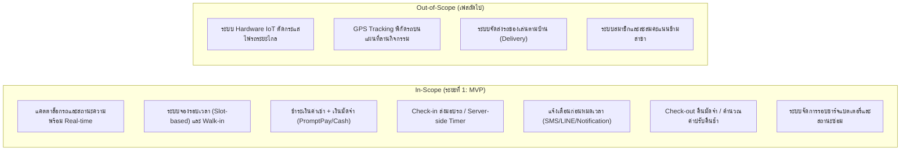

# เอกสารวิเคราะห์ความต้องการ: ระบบจองรถของเล่น (Toy Car Booking & Fleet System)

> **มาตรฐานอ้างอิง:** Skill `01-requirements-engineering`  
> **สถานะ:** Draft Specification (Ready for Architecture & Design)  
> **ประเภทระบบ:** Web Application (Customer Mobile Web + Staff POS/Tablet Console)

---

## 1. Problem Statement (แยก Problem vs Solution)

### ปัญหาที่พบในกระบวนการปัจจุบัน (Problem Statement)
1. **การรอคิวที่ไม่แน่นอน (Uncertain Waiting Time):** ลูกค้าและผู้ปกครองต้องยืนรอคิวหน้าบูธ โดยไม่ทราบเวลาที่รถคันที่ต้องการจะว่าง ทำให้เกิดความแออัดและเสียเวลา
2. **การจัดการตารางเวลาทับซ้อน (Scheduling Conflict):** การบันทึกรอบเวลาลงสมุดกระดาษทำให้เกิดข้อผิดพลาดในการปล่อยรถซ้อนคัน หรือปล่อยให้ลูกค้าเล่นเกินเวลาโดยไม่มีการแจ้งเตือน
3. **ปัญหาความพร้อมของยานพาหนะ (Fleet & Battery Depletion):** พนักงานไม่สามารถติดตามรอบการชาร์จแบตเตอรี่และประวัติความเสียหาย ส่งผลให้รถแบตเตอรี่หมดกลางทางระหว่างที่เด็กกำลังเล่น
4. **ความผิดพลาดในการจัดการเงินมัดจำและค่าปรับ (Deposit & Overtime Leakage):** การจัดการเงินสดและค่ามัดจำกุญแจ/รีโมทไม่มีระบบ Audit Trail ที่รัดกุม ทำให้เกิดข้อพิพาทเรื่องการคืนรถช้า

### แนวทางแก้ไข (Proposed Solution)
พัฒนาระบบบริหารจัดการและจองรถของเล่นแบบดิจิทัล (Toy Car Booking & Fleet Management System) ที่รองรับการจองล่วงหน้าผ่านมือถือและการ Walk-in หน้าร้าน พร้อมระบบจับเวลากลาง (Server-side Timer) แจ้งเตือนอัตโนมัติ และติดตามรอบการชาร์จแบตเตอรี่

---

## 2. ขอบเขตของโครงการ (Scope & Boundaries)

---

## 3. แผนผังผู้มีส่วนได้ส่วนเสีย (Stakeholder Map)

1. **ผู้ปกครอง / ลูกค้า (Customer / Parent):** ค้นหารถ เลือกรอบเวลา จ่ายเงิน รับการแจ้งเตือนเวลา และรับเงินมัดจำคืน
2. **พนักงานหน้าร้าน (Booth Staff):** สแกนรับรถ (Check-in) ตรวจสภาพรถ ส่งมอบรีโมท คุมเวลา และทำรายการคืนรถ (Check-out)
3. **พนักงานซ่อมบำรุง (Maintenance / Battery Crew):** บันทึกการชาร์จไฟ อัปเดตรถที่ชาร์จเต็ม และบันทึกงานซ่อม
4. **ผู้จัดการ / เจ้าของกิจการ (Business Owner / Admin):** กำหนดอัตราค่าบริการ จัดการรอบเวลา ดูรายงานรายได้ และสถิติการใช้งาน

---

## 4. Functional Requirements (FR)

* **FR-01 (Vehicle Catalog & Availability):** ระบบต้องแสดงรายการรถของเล่น แบ่งตามรุ่น ขนาด น้ำหนักสูงสุดที่รองรับ และสถานะปัจจุบัน (`Available`, `Booked`, `In-Use`, `Charging`, `Maintenance`)
* **FR-02 (Slot-based Booking):** ระบบต้องให้ผู้ใช้เลือกรอบเวลาเช่า (15, 30, 60 นาที) และทำการกักสิทธิ์รถชั่วคราว (Hold) เป็นเวลา 5 นาที เพื่อรอการชำระเงิน
* **FR-03 (Payment & Deposit Collection):** ระบบต้องคำนวณและรับชำระเงินค่าเช่ารวมกับค่ามัดจำอุปกรณ์ (100 บาท) พร้อมสร้างใบยืนยันการจองในรูปแบบ QR Ticket
* **FR-04 (Check-in & Dispatch):** พนักงานสามารถสแกน QR Ticket เพื่อตรวจสอบความถูกต้อง บันทึกสภาพรถก่อนเล่น และเริ่มสั่งนับเวลารอบการเล่นบนระบบ
* **FR-05 (Real-time Session Tracking & Alerts):** ระบบต้องจับเวลารอบการเล่นด้วย Server Authoritative Timer และส่งข้อความแจ้งเตือนไปยังผู้ปกครองล่วงหน้า 5 นาทีก่อนหมดเวลา
* **FR-06 (Check-out & Penalty Settlement):** พนักงานสามารถสแกนจบการเล่น ตรวจสภาพรถ คืนมัดจำ และคิดค่าปรับกรณีคืนรถเกินเวลาตามเกณฑ์ที่กำหนด
* **FR-07 (Fleet Battery & Maintenance):** ระบบต้องติดตามรอบการใช้งานสะสม และบังคับเปลี่ยนสถานะรถเป็น `Charging` โดยอัตโนมัติเมื่อครบ 3 รอบการเล่น

---

## 5. Non-Functional Requirements (NFR)

* **NFR-01 (Performance & Concurrency):** ระบบต้องป้องกันการจองชนกัน (Double Booking) 100% ผ่าน Database Transaction Locking และต้องโหลดหน้าตารางเวลาได้ภายใน 1.5 วินาที
* **NFR-02 (Timer Reliability):** การนับเวลาต้องใช้เวลาจากเซิร์ฟเวอร์เป็นหลัก (Server-authoritative) เพื่อป้องกันปัญหาเวลาเดินไม่ตรงหรือการโกงเวลาเมื่อฝั่งเครื่องผู้ใช้หลุดการเชื่อมต่อ
* **NFR-03 (Usability):** หน้าจอลูกค้าต้องเป็น Mobile-First Responsive สามารถทำรายการจองและจ่ายเงินเสร็จสิ้นภายใน 4 ขั้นตอน ส่วนหน้าจอพนักงานต้องใช้งานได้สะดวกบน Tablet
* **NFR-04 (Security & Privacy):** ข้อมูลส่วนบุคคล (ชื่อและเบอร์โทรศัพท์ผู้ปกครอง) ต้องได้รับการจัดเก็บอย่างปลอดภัยตามมาตรฐาน PDPA ไม่เปิดเผยต่อบุคคลภายนอก และมีการจัดเก็บ Transaction Log สำหรับทุกรายการเงิน
* **NFR-05 (Availability):** ระบบต้องมี Uptime ไม่ต่ำกว่า 99.5% ในช่วงเวลาเปิดให้บริการของบูธ (10:00 - 22:00 น.)

---

## 6. User Stories & Acceptance Criteria

### US-01: การดูสถานะและจองรอบเวลารถ
> **ในฐานะ** ผู้ปกครอง  
> **ฉันต้องการ** ดูรายการรถที่ว่างและเลือกรอบเวลาล่วงหน้า  
> **เพื่อที่จะ** วางแผนพาลูกมาเล่นได้โดยไม่ต้องยืนรอคิวนาน

* **AC-01.1 (จองรอบที่ว่างสำเร็จ):**
  * **Given** รถคันที่เลือกมีสถานะ `Available` ในช่วงเวลา 14:00 - 14:30
  * **When** ผู้ปกครองกดเลือกคันและช่วงเวลาดังกล่าว
  * **Then** ระบบต้องเปลี่ยนสถานะรถเป็น `Hold` สำหรับลูกค้ารายนั้นเป็นเวลา 5 นาที และนำทางไปหน้าชำระเงิน
* **AC-01.2 (ป้องกันการจองซ้อน):**
  * **Given** รถคันหนึ่งกำลังถูก Hold หรือ Confirm โดยลูกค้ารายอื่น
  * **When** ผู้ปกครองอีกท่านพยายามกดจองรอบเดียวกัน
  * **Then** ระบบต้องแจ้งเตือนว่า "รอบเวลานี้ถูกจองแล้ว กรุณาเลือกรอบอื่นหรือรถคันอื่น"

---

### US-02: การชำระเงินและออก QR Ticket
> **ในฐานะ** ผู้ปกครอง  
> **ฉันต้องการ** ชำระเงินค่าเช่ารวมค่ามัดจำผ่าน QR Code PromptPay  
> **เพื่อที่จะ** ยืนยันการจองได้ทันทีโดยไม่ต้องใช้เงินสด

* **AC-02.1 (ชำระเงินสำเร็จตามกำหนด):**
  * **Given** รายการจองอยู่ในสถานะ Hold ภายใน 5 นาที
  * **When** ผู้ปกครองสแกนจ่ายเงินผ่าน QR PromptPay สำเร็จ
  * **Then** สถานะการจองเปลี่ยนเป็น `Confirmed` และระบบแสดง QR Ticket สำหรับนำไปแสดงหน้าร้าน
* **AC-02.2 (หมดเวลาชำระเงิน):**
  * **Given** รายการจองอยู่ในสถานะ Hold
  * **When** เวลาผ่านไปเกิน 5 นาทีโดยไม่พบยอดเงินเข้า
  * **Then** ระบบยกเลิกรายการจองอัตโนมัติ และคืนสถานะรถกลับเป็น `Available` ทันที

---

### US-03: การส่งมอบรถและเริ่มจับเวลา (Check-in)
> **ในฐานะ** พนักงานหน้าร้าน  
> **ฉันต้องการ** สแกน QR Ticket ของลูกค้าเพื่อส่งมอบรถและกดยืนยันการเริ่มเล่น  
> **เพื่อที่จะ** บันทึกการปล่อยรถและเริ่มนับเวลาอย่างถูกต้อง

* **AC-03.1 (Check-in ถูกต้อง):**
  * **Given** ลูกค้าแสดง QR Ticket ที่มีสถานะ `Confirmed` และตรงกับรอบเวลาปัจจุบัน (ยอมรับการมาก่อนเวลาได้ไม่เกิน 5 นาที)
  * **When** พนักงานสแกน QR Ticket ตรวจสภาพรถเบื้องต้น และกดยืนยัน "ส่งมอบรถ"
  * **Then** สถานะรถเปลี่ยนเป็น `In-Use` และ Server เริ่มนับถอยหลังตามระยะเวลาของแพ็กเกจ

---

### US-04: การแจ้งเตือนก่อนหมดเวลา
> **ในฐานะ** ผู้ปกครอง  
> **ฉันต้องการ** ได้รับข้อความแจ้งเตือนเมื่อเหลือเวลาเล่น 5 นาที  
> **เพื่อที่จะ** สามารถเตือนบุตรหลานและนำรถกลับมาคืนที่บูธได้ทันเวลา

* **AC-04.1 (แจ้งเตือนล่วงหน้า 5 นาที):**
  * **Given** รถกำลังอยู่ในสถานะ `In-Use`
  * **When** เวลาที่เหลือในรอบการเล่นลดลงมาเหลือ 5 นาทีพอดี
  * **Then** ระบบส่งข้อความแจ้งเตือน (SMS หรือ Notification) ไปยังเบอร์โทรศัพท์ของผู้ปกครองที่ระบุไว้

---

### US-05: การรับคืนรถ ตรวจสอบค่าปรับ และคืนเงินมัดจำ (Check-out)
> **ในฐานะ** พนักงานหน้าร้าน  
> **ฉันต้องการ** ทำรายการรับรถคืน ตรวจสอบสภาพ และสรุปยอดหักค่าปรับ (ถ้ามี)  
> **เพื่อที่จะ** คืนเงินมัดจำและปิดรอบการเช่าอย่างโปร่งใส

* **AC-05.1 (คืนรถตรงเวลาหรือในระยะ Grace Period):**
  * **Given** ลูกค้านำรถมาคืนโดยเกินเวลาไม่เกิน 5 นาที (Grace Period)
  * **When** พนักงานตรวจสอบสภาพรถและรีโมทคอนโทรลว่าสมบูรณ์
  * **Then** ระบบทำรายการคืนเงินมัดจำเต็มจำนวน 100 บาท และเปลี่ยนสถานะรอบเป็น `Completed`
* **AC-05.2 (คืนรถเกินเวลาที่ผ่อนผัน):**
  * **Given** ลูกค้านำรถมาคืนช้ากว่ากำหนด 12 นาที (เกิน Grace Period 5 นาที คิดค่าปรับส่วนเกิน 7 นาที)
  * **When** พนักงานกดคำนวณ Check-out
  * **Then** ระบบคำนวณค่าปรับนาทีละ 10 บาท (70 บาท) และแสดงยอดคืนมัดจำสุทธิ 30 บาท (100 - 70) พร้อมบันทึกหลักฐาน

---

## 7. Business Rules (กฎทางธุรกิจ)

* **BR-01 (รอบเวลาการเช่า):** อนุญาตให้เลือกจองรอบเวลาได้ 3 ระดับคือ 15 นาที, 30 นาที และ 60 นาที ไม่อนุญาตให้แบ่งย่อยต่ำกว่า 15 นาที
* **BR-02 (ข้อจำกัดด้านความปลอดภัย):** รถแต่ละรุ่นต้องมีข้อกำหนดน้ำหนักและอายุชัดเจน (เช่น รถขนาดเล็กรับน้ำหนักไม่เกิน 25 กิโลกรัม, รถขนาดใหญ่ไม่เกิน 40 กิโลกรัม) ผู้ปกครองต้องกดยอมรับเงื่อนไขความปลอดภัยก่อนจอง
* **BR-03 (เงินมัดจำ):** ทุกรอบการเช่าต้องเรียกเก็บเงินมัดจำคงที่ 100 บาทต่อคันเพื่อเป็นหลักประกันตัวรถและรีโมทคอนโทรล
* **BR-04 (เกณฑ์ผ่อนผันและค่าปรับ):**
  * ผ่อนผันการคืนรถล่าช้าได้ไม่เกิน 5 นาที (Grace Period)
  * หากเกิน 5 นาที จะคิดค่าปรับนาทีละ 10 บาท โดยหักจากเงินมัดจำ หากค่าปรับเกินกว่า 100 บาท ลูกค้าต้องชำระส่วนต่างเพิ่มก่อนเสร็จสิ้น
* **BR-05 (การพักชาร์จแบตเตอรี่):** รถ 1 คัน สามารถให้บริการติดต่อกันได้สูงสุด 3 รอบ (หรือสะสมเวลาครบ 90 นาที) หลังจากนั้นระบบจะบังคับล็อกสถานะเป็น `Charging` โดยอัตโนมัติอย่างน้อย 45 นาที
* **BR-06 (นโยบายการยกเลิก):**
  * หากลูกค้ายกเลิกล่วงหน้าเกิน 15 นาทีก่อนเริ่มรอบเวลา: คืนเงินค่าเช่าและเงินมัดจำเต็มจำนวน 100%
  * หากลูกค้ายกเลิกน้อยกว่า 15 นาที หรือไม่มาแสดงตัว (No-show): ขอสงวนสิทธิ์ไม่คืนเงินค่าเช่า (คืนเฉพาะเงินมัดจำ)

---

## 8. Assumptions, Constraints & Risk Analysis

| ประเภท | รายละเอียด | แผนรับมือ / การจัดการ (Mitigation) |
|---|---|---|
| **Assumption** | ผู้ปกครองมีสมาร์ตโฟนที่สามารถรับ SMS และเปิดดูหน้าเว็บ QR Ticket ได้ | หน้าร้านมีแท็บเล็ตสำหรับโหมด Walk-in และสามารถพิมพ์สลิปกระดาษได้ |
| **Assumption** | บูธมีสัญญาณอินเทอร์เน็ตพร้อมใช้งานตลอดเวลา | แอพพนักงานรองรับ Local Cache กรณีเน็ตดับชั่วคราว |
| **Constraint** | ไม่มีระบบตัดไฟรถยนต์ระยะไกลผ่าน IoT ในเฟสแรก | อาศัยรีโมทคอนโทรลระยะ 30 เมตรที่พนักงานหรือผู้ปกครองถือในการหยุดรถ |
| **Risk 1 (High)** | ลูกค้าขับรถเลยออกนอกบริเวณลานกิจกรรม | กำหนดพื้นที่ป้ายกั้นชัดเจน และพนักงานมีเบอร์โทรผู้ปกครองสำหรับติดต่อทันที |
| **Risk 2 (Medium)** | แบตเตอรี่รถเสื่อม ทำให้รถหยุดวิ่งก่อนหมดเวลา | บังคับใช้ BR-05 (ตรวจเช็กและชาร์จทุก 3 รอบ) พร้อมมีรถสำรองสลับเปลี่ยน |
| **Risk 3 (Low)** | มีการทุจริตเงินมัดจำหรือค่าปรับหน้าร้าน | ปรับใช้การบันทึก Audit Log ดิจิทัล ทุกยอดเงินมัดจำและค่าปรับต้องระบุเหตุผลในระบบ |

---

## 9. Requirement Traceability Table (ตารางเชื่อมโยงความต้องการ)

| Requirement ID | รายละเอียดความต้องการ | User Story | Acceptance Criteria | Business Rule | วิธีการทดสอบ / Verification |
|---|---|---|---|---|---|
| **FR-01** | แคตตาล็อกรถและสถานะ Real-time | US-01 | AC-01.1, AC-01.2 | BR-02, BR-05 | ตรวจสอบตารางแสดงผลสถานะ และการเปลี่ยนสีตามสถานะรถ |
| **FR-02** | ระบบจองรอบเวลาและ Hold สิทธิ์ 5 นาที | US-01 | AC-01.1, AC-01.2 | BR-01 | ทดสอบการจองพร้อมกัน 2 อุปกรณ์ (Concurrency Test) และการหมดอายุ Hold |
| **FR-03** | ชำระเงินค่าเช่า + มัดจำ และออก QR Ticket | US-02 | AC-02.1, AC-02.2 | BR-03, BR-06 | จำลอง Webhook แจ้งชำระเงินสำเร็จ / ตรวจสอบความถูกต้องของ QR Ticket |
| **FR-04** | Check-in ส่งมอบรถและเริ่มนับเวลา | US-03 | AC-03.1 | BR-02 | ทดสอบสแกน QR Ticket ที่ถูกต้องและที่หมดอายุ/ไม่ตรงรอบ |
| **FR-05** | จับเวลากลางและส่งการแจ้งเตือน | US-04 | AC-04.1 | BR-04 | จำลอง Timer เหลือ 5 นาที และตรวจสอบ Event Dispatcher ไปยัง SMS/Notification Gateway |
| **FR-06** | Check-out ตรวจสภาพ คืนมัดจำ และคำนวณค่าปรับ | US-05 | AC-05.1, AC-05.2 | BR-03, BR-04 | ทดสอบคืนรถ: 1) ปกติ 2) ช้าใน Grace Period 3) ช้าเกิน Grace Period |
| **FR-07** | จัดการรอบชาร์จแบตเตอรี่อัตโนมัติ | - | - | BR-05 | รัน Session ครบ 3 ครั้ง ตรวจสอบว่าระบบเปลี่ยนสถานะเป็น `Charging` และไม่อนุญาตให้จอง |

---

## 10. สรุปขั้นตอนถัดไป (Next Steps)
เอกสารนี้พร้อมสำหรับนำไปใช้เป็น Input ในขั้นตอนถัดไปของ Software Engineering Workflow:
1. **02-system-design**: ออกแบบ High-level System Architecture, Component และ Data Flow
2. **03-software-architecture**: กำหนด Folder Structure, Clean Architecture และ State Pattern สำหรับการจัดการสถานะรถ
3. **04-database-design**: ออกแบบตาราง Database Schema (Vehicles, Slots, Bookings, Sessions, Transactions)
