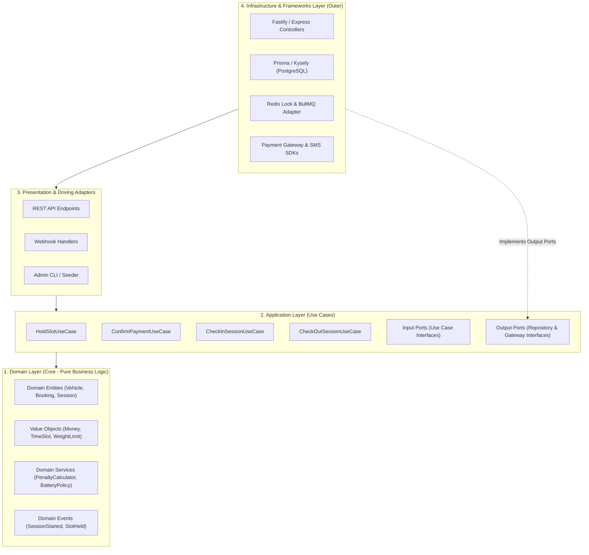
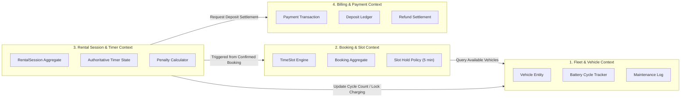
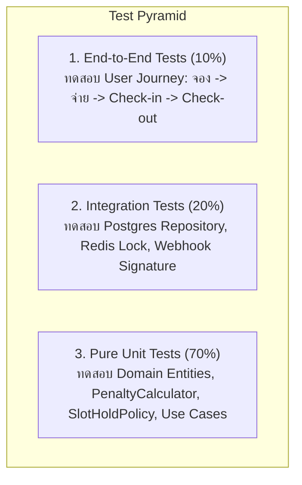

# เอกสารสถาปัตยกรรมซอฟต์แวร์: ระบบจองรถของเล่น (Software Architecture Specification)

> **มาตรฐานอ้างอิง:** Skill `03-software-architecture`  
> **อ้างอิงเอกสารก่อนหน้า:**  
> - Requirement: [`docs/requirements-toy-car-booking.md`](file:///c:/เสรี/docs/requirements-toy-car-booking.md)  
> - System Design: [`docs/system-design-toy-car-booking.md`](file:///c:/เสรี/docs/system-design-toy-car-booking.md)  
> **รูปแบบสถาปัตยกรรม (Pattern):** Clean / Hexagonal Architecture (Ports & Adapters) ภายใน Modular Monolith

---

## 1. รูปแบบสถาปัตยกรรม (Architecture Style Selection)

ระบบถูกออกแบบโดยใช้ **Clean Architecture (Hexagonal / Ports & Adapters)** ภายใต้ขอบเขต **Modular Monolith** เพื่อแยกแกนกลางของตรรกะทางธุรกิจ (Domain Logic เช่น กฎการคิดค่าปรับ, การนับรอบแบตเตอรี่, การกักสิทธิ์ Slot) ให้อิสระจาก Database, HTTP Frameworks และ Third-party SDKs



---

## 2. ขอบเขตโดเมนและโมดูล (Domain Boundaries / Bounded Contexts)

ระบบถูกแบ่งออกเป็น 4 Bounded Contexts ชัดเจนตามความรับผิดชอบทางธุรกิจ:



---

## 3. โครงสร้างโฟลเดอร์และการแบ่งเลเยอร์ (Module Directory Structure)

โครงสร้างโฟลเดอร์จัดระเบียบตามโมดูล (Package-by-Feature) โดยภายในแต่ละโมดูลจะแยกย่อยเป็น Clean Architecture Layers:

```text
src/
├── core/                               # Shared Kernel (Cross-cutting Concerns)
│   ├── domain/                         # BaseEntity, ValueObject, DomainEvent
│   ├── errors/                         # AppError, DomainException
│   └── events/                         # EventBus Interface & In-memory Dispatcher
├── modules/
│   ├── fleet/                          # โมดูลจัดการตัวรถและแบตเตอรี่
│   │   ├── domain/                     # Vehicle, BatteryCycle, VehicleStatus Enum
│   │   ├── application/                # UpdateBatteryStatusUseCase, GetAvailableVehicles
│   │   ├── infrastructure/             # PostgresVehicleRepository
│   │   └── presentation/               # VehicleController
│   ├── booking/                        # โมดูลจองรอบเวลา
│   │   ├── domain/                     # Booking, TimeSlot, SlotLockService
│   │   ├── application/                # HoldSlotUseCase, ConfirmBookingUseCase
│   │   │   └── ports/                  # IBookingRepository, ISlotLockRepository
│   │   ├── infrastructure/             # PostgresBookingRepository, RedisSlotLockAdapter
│   │   └── presentation/               # BookingController
│   ├── session/                        # โมดูลจับเวลารอบเล่นและ Check-in/Check-out
│   │   ├── domain/                     # RentalSession, PenaltyCalculator (Pure Logic)
│   │   ├── application/                # StartSessionUseCase, EndSessionUseCase
│   │   │   └── ports/                  # ISessionRepository, ITimerQueuePort
│   │   ├── infrastructure/             # PostgresSessionRepository, BullMQTimerAdapter
│   │   └── presentation/               # SessionController
│   └── billing/                        # โมดูลการชำระเงินและจัดการเงินมัดจำ
│       ├── domain/                     # PaymentTransaction, DepositLedger
│       ├── application/                # ProcessPaymentWebhookUseCase, RefundDepositUseCase
│       │   └── ports/                  # IPaymentGatewayPort, ILedgerRepository
│       ├── infrastructure/             # OmisePaymentGatewayAdapter, PostgresLedgerRepo
│       └── presentation/               # PaymentWebhookController
└── app.ts                              # Dependency Injection Bootstrapper & Server Init
```

---

## 4. ทิศทางการขึ้นต่อกัน (Dependency Rules & Inversion)

* **The Dependency Rule:** โค้ดในเลเยอร์ชั้นใน (Domain และ Application) **ต้องไม่รู้จัก** โค้ดในเลเยอร์ชั้นนอก (Infrastructure, Database, ORM, Web Frameworks)
* **Dependency Inversion Principle (DIP):**
  * `HoldSlotUseCase` (Application) ต้องการบันทึกข้อมูล จะเรียกผ่าน Interface `IBookingRepository`
  * `PostgresBookingRepository` (Infrastructure) จะเป็นตัว Implement Interface นั้น
  * การเชื่อมต่อ Object จะทำผ่าน Dependency Injection (DI) Container ตอนเริ่มต้นระบบ

```typescript
// Domain / Application Layer: ไม่นำเข้า Prisma, Postgres หรือ Redis
export interface ISlotLockRepository {
  acquireLock(vehicleId: string, slotTime: Date, ttlSeconds: number): Promise<boolean>;
  releaseLock(vehicleId: string, slotTime: Date): Promise<void>;
}

// Application Layer: Use Case ขึ้นต่อ Interface เท่านั้น
export class HoldSlotUseCase {
  constructor(
    private readonly slotLockRepo: ISlotLockRepository,
    private readonly bookingRepo: IBookingRepository
  ) {}

  async execute(dto: HoldSlotDTO): Promise<BookingResult> {
    const locked = await this.slotLockRepo.acquireLock(dto.vehicleId, dto.slotTime, 300);
    if (!locked) {
      throw new SlotAlreadyReservedException("รอบเวลานี้ถูกเลือกแล้ว");
    }
    // Business logic...
  }
}
```

---

## 5. การประยุกต์ใช้หลัก SOLID Principles

| หลักการ | การนำมาใช้งานในระบบนี้ | ตัวอย่างที่เป็นรูปธรรม |
|---|---|---|
| **S - Single Responsibility** | แต่ละคลาสมีเหตุผลในการเปลี่ยนแปลงเพียงข้อเดียว | `PenaltyCalculator` รับผิดชอบเฉพาะสูตรคำนวณค่าปรับตามเวลาคืนรถจริง ไม่ยุ่งเกี่ยวกับการเขียน Database หรือการหักเงินมัดจำ |
| **O - Open / Closed** | เปิดให้ขยายการทำงาน แต่ปิดการแก้ไขโค้ดเดิม | พอร์ต `IPaymentGateway` ถูกออกแบบให้อิสระ หากในอนาคตต้องการเพิ่มผู้ให้บริการ TrueMoney หรือ บัตรเครดิต สามารถเขียน Adapter ใหม่ขึ้นมาเสียบได้ทันทีโดยไม่ต้องแก้ Use Case |
| **L - Liskov Substitution** | คลาสที่ Implement Interface เดียวกันต้องแทนที่กันได้สมบูรณ์ | การสลับใช้ `PostgresBookingRepository` กับ `InMemoryBookingRepository` ใน Unit Test ต้องให้ผลลัพธ์ของฟังก์ชันทางตรรกะเหมือนกันทุกประการ |
| **I - Interface Segregation** | ไม่บังคับให้คลาส Implement เมธอดที่ตนเองไม่ได้ใช้ | แยก `IVehicleAvailabilityReader` (สำหรับระบบจองอ่านอย่างเดียว) ออกจาก `IVehicleMaintenanceWriter` (สำหรับช่างอัปเดตสถานะชาร์จแบต) |
| **D - Dependency Inversion** | High-level Modules ต้องไม่พึ่งพา Low-level Modules | `CheckOutSessionUseCase` พึ่งพา Abstractions เช่น `ISessionRepository`, `ITimerQueuePort`, `INotificationPort` แทนการเรียกใช้ BullMQ หรือ Prisma ตรงๆ |

---

## 6. Coupling & Cohesion Analysis

### 1. High Cohesion (ความสอดคล้องกลมกลืนภายในโมดูลสูง)
* ภายใน `modules/fleet`: รวบรวมฟังก์ชันเกี่ยวกับสเปกรถ, เกณฑ์น้ำหนักเด็ก, การนับรอบการเล่นสะสม, และการเปลี่ยนสถานะเข้าชาร์จแบตเตอรี่ ทุกอย่างที่เกี่ยวกับกายภาพและสถานะของรถรวมอยู่ที่นี่ทั้งหมด
* ภายใน `modules/session`: รวมตรรกะการจับเวลากลาง, การตรวจรับรถ, การตรวจสภาพตอนคืน, และการคำนวณส่วนต่างเวลา

### 2. Loose Coupling (การเชื่อมโยงระหว่างโมดูลต่ำ)
* **ห้ามทำการ Cross-Database Query:** ห้ามโมดูล `session` ทำ SQL Join ตรงไปยังตาราง `billing_ledger` ของโมดูลการเงิน
* **สื่อสารผ่าน Domain Events หรือ Module Facade:**
  * เมื่อพนักงาน Check-out สำเร็จ โมดูล Session จะยิง Event `SessionCompletedEvent { sessionId, penaltyAmount, netDepositRefund }`
  * โมดูล `billing` จะ Subscribe Event นี้ แล้วทำการสร้างรายการลงบัญชีคืนเงินมัดจำโดยอัตโนมัติ ทำให้โมดูล Session ไม่ต้องผูกติดกับ Payment Gateway

---

## 7. กลยุทธ์การทดสอบ (Testability Strategy)



1. **Unit Testing (ไร้ Dependency ภายนอก):**
   * Domain Logic และ Use Cases ทั้งหมดถูกทดสอบด้วย `vitest` หรือ `jest` โดย Mock Ports ด้วย Fake In-memory Repositories ทำให้รันเทสต์หลักร้อยเคสเสร็จได้ในระดับมิลลิวินาที
2. **Integration Testing (ตรวจสอบความถูกต้องของ Adapter):**
   * ใช้ **Testcontainers** เพื่อรัน PostgreSQL และ Redis จริงใน Docker ขณะทดสอบ Repository queries เพื่อตรวจสอบ SQL Constraints, Unique Indexes, และการทำงานของ `SELECT ... FOR UPDATE`
3. **Deterministic Time Testing:**
   * สถาปัตยกรรมใช้ `ClockProvider` Interface (เช่น `IClock { now(): Date }`) แทนการเรียก `new Date()` ตรงๆ ใน Domain ช่วยให้สามารถจำลองเวลาเดินไปข้างหน้า (Time Travel) เพื่อทดสอบกรณี Grace Period 5 นาที หรือการนับถอยหลังได้อย่างแม่นยำ

---

## 8. Architecture Decision Records (ADR)

### ADR-001: การเลือกใช้ Modular Monolith แทน Microservices
* **สถานะ:** Accepted
* **บริบท:** ระบบเช่ารถของเล่นมีขนาดทราฟฟิกเริ่มต้น 1-10 สาขา ปริมาณ Transaction ต่อวันอยู่ในระดับ 500 - 5,000 รายการ
* **การตัดสินใจ:** เลือกใช้ Modular Monolith ที่มีการแบ่ง Bounded Context และ Clean Architecture ชัดเจน
* **ผลลัพธ์ (Consequences):**
  * *ข้อดี:* ลดความซับซ้อนในการ Deploy, ประหยัดค่า Infrastructure, จัดการ Distributed Transaction ของการเงินและตารางเวลาได้ง่ายด้วย DB Transaction
  * *ข้อแลกเปลี่ยน:* ต้องเคร่งครัดเรื่องกฎการห้าม Cross-query ระหว่างโมดูล เพื่อให้สามารถแยกเป็น Microservices ได้ในอนาคตหากจำเป็น

### ADR-002: การใช้ Clean Architecture (Ports & Adapters)
* **สถานะ:** Accepted
* **บริบท:** กฎทางธุรกิจ เช่น การคำนวณค่าปรับคืนรถล่าช้า, การกักสิทธิ์เวลา และการสลับชาร์จแบตเตอรี่ มีความสำคัญสูงสุดและอาจมีการปรับเปลี่ยนเกณฑ์บ่อยครั้ง
* **การตัดสินใจ:** แยก Business Logic ออกจาก Framework และฐานข้อมูล โดย Use Case สื่อสารผ่าน Interfaces (Ports)
* **ผลลัพธ์ (Consequences):**
  * *ข้อดี:* เทสต์ง่ายมาก (Testability สูง), สลับ Database หรือเปลี่ยน Payment Provider ได้โดยไม่กระทบ Business Rules
  * *ข้อแลกเปลี่ยน:* มี Boilerplate โค้ดเพิ่มขึ้น (ต้องเขียน Interface, DTO, Entity Mappers)

### ADR-003: การใช้ Domain Event Bus สำหรับสื่อสารระหว่างโมดูล
* **สถานะ:** Accepted
* **บริบท:** เมื่อเกิดการ Check-out จะต้องมีการปรับสถานะรอบแบตเตอรี่ของรถ และการคืนเงินมัดจำ
* **การตัดสินใจ:** ใช้ In-Memory Event Bus (เช่น EventEmitter2 หรือ MediatR pattern) เพื่อสื่อสารแบบ Asynchronous Decoupling ระหว่างโมดูล
* **ผลลัพธ์ (Consequences):**
  * *ข้อดี:* แต่ละโมดูลไม่ต้องอ้างอิง Service ของกันและกัน (Zero Direct Coupling)
  * *ข้อแลกเปลี่ยน:* ต้องระวังเรื่อง Transaction Consistency (Event Handler ทำงานล้มเหลว) จึงต้องมี Outbox Pattern หรือ Retry Mechanism รองรับ

### ADR-004: การจับเวลากลางด้วย Redis BullMQ Delayed Jobs
* **สถานะ:** Accepted
* **บริบท:** การแจ้งเตือนผู้ปกครองล่วงหน้า 5 นาทีก่อนหมดเวลา ต้องทำงานได้แม้ผู้ปกครองปิดแอพมือถือ
* **การตัดสินใจ:** ใช้ BullMQ บน Redis เพื่อส่ง Delayed Job ไปยังเวลา `start_time + duration - 5 นาที`
* **ผลลัพธ์ (Consequences):**
  * *ข้อดี:* แม่นยำ ไม่เปลือง CPU ในการทำ Polling วนลูป, ทนทานต่อการ Restart ของเซิร์ฟเวอร์
  * *ข้อแลกเปลี่ยน:* ต้องมี Redis Instance ที่เปิดฟังก์ชัน AOF Persistence เพื่อไม่ให้ข้อมูล Job สูญหาย

### ADR-005: กลยุทธ์การป้องกัน Double-Booking (Two-Phase Locking)
* **สถานะ:** Accepted
* **บริบท:** มีโอกาสสูงที่ผู้ปกครองหลายท่านจะแย่งกดจองรถรุ่นยอดนิยมในรอบเวลาเดียวกัน
* **การตัดสินใจ:**
  1. *Phase 1 (Pre-booking):* ใช้ Redis `SETNX` แบบมี TTL 5 นาที เพื่อกักสิทธิ์อย่างรวดเร็ว
  2. *Phase 2 (Confirmation):* ใช้ PostgreSQL Unique Constraint `(vehicle_id, slot_start_time)` และ `SERIALIZABLE` / `SELECT FOR UPDATE` ยืนยันการจองจริง
* **ผลลัพธ์ (Consequences):**
  * *ข้อดี:* ตอบสนองไว ป้องกัน Race Condition ได้ 100% ไม่มีหลุด
  * *ข้อแลกเปลี่ยน:* ต้องจัดการเคลียร์ Redis Key เมื่อการชำระเงินไม่สำเร็จหรือหมดเวลา

---

## 9. จุดเสี่ยงทางสถาปัตยกรรม (Architecture Risks & Mitigation)

1. **สถาปัตยกรรมเสื่อมสภาพจากการ Cross-Module Import (Architectural Erosion):**
   * *ความเสี่ยง:* นักพัฒนาใหม่อาจ import service ข้ามโมดูลตรงๆ หรือเขียน Raw SQL Join ข้ามโมดูล
   * *การป้องกัน:* ติดตั้ง **`eslint-plugin-boundaries`** หรือเครื่องมือเช่น **`dependency-cruiser`** ใน CI Pipeline เพื่อบังคับกฎการห้าม import ข้ามโมดูลโดยไม่ผ่าน Public Interface
2. **Eventual Consistency Failure:**
   * *ความเสี่ยง:* Check-out เสร็จสิ้นแต่ Event คืนมัดจำล้มเหลวเนื่องจาก Payment Gateway ขัดข้อง
   * *การป้องกัน:* ใช้ **Transactional Outbox Pattern** บันทึก Event ลงฐานข้อมูลใน Transaction เดียวกันกับ Check-out เพื่อให้ Worker ดึงไป Retry จนสำเร็จ
