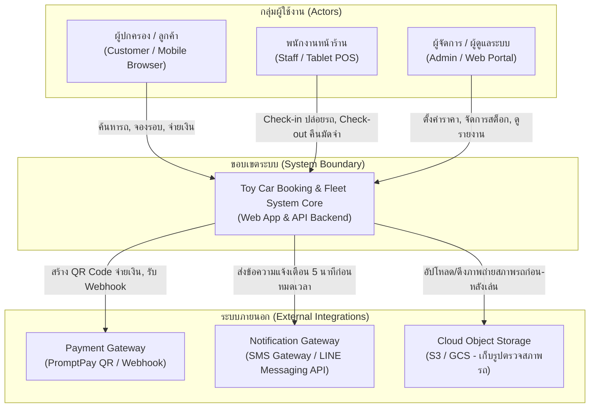
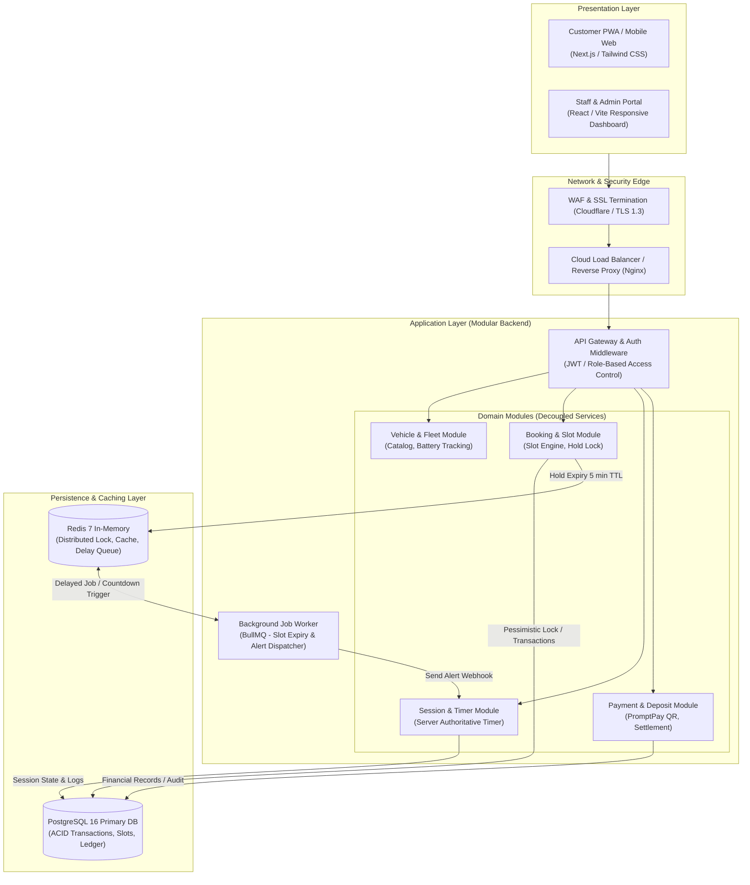
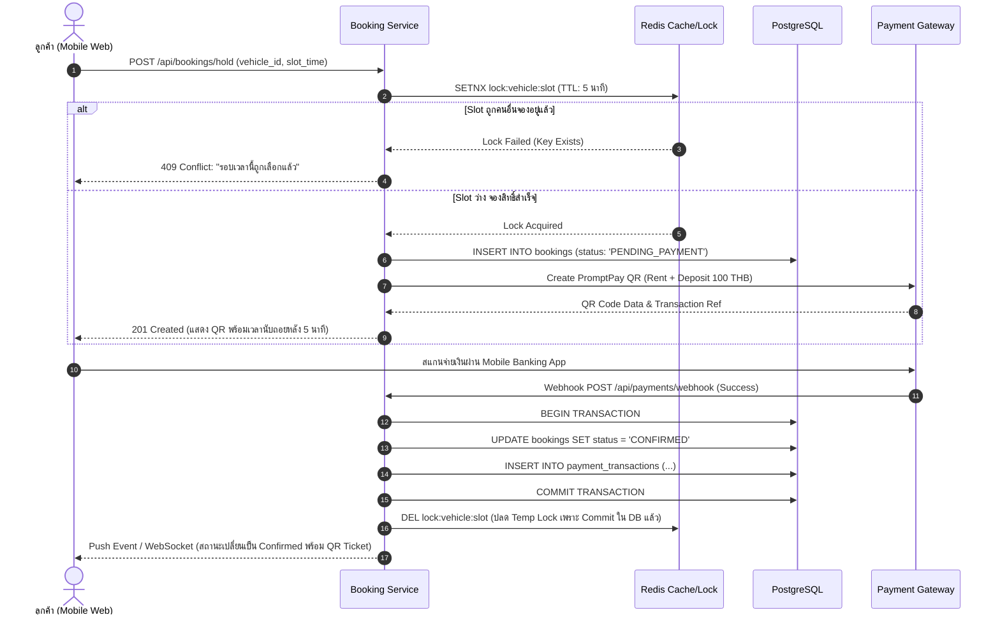
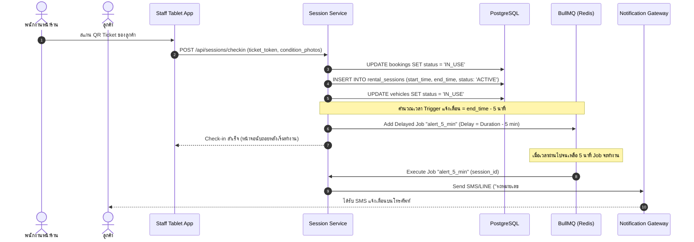
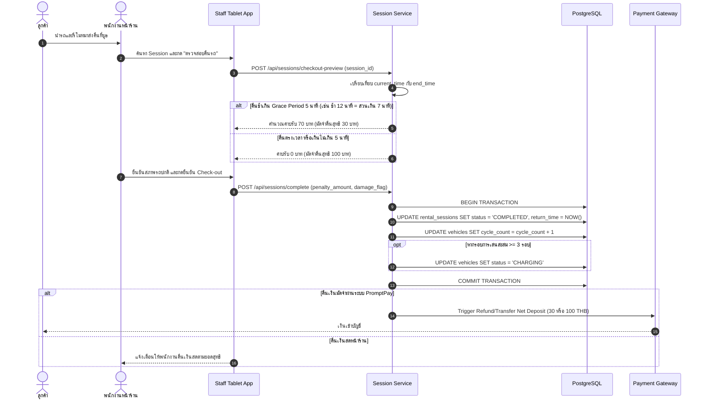

# เอกสารการออกแบบระบบ: ระบบจองรถของเล่น (System Design Specification)

> **มาตรฐานอ้างอิง:** Skill `02-system-design`  
> **อ้างอิง Requirement:** [`docs/requirements-toy-car-booking.md`](file:///c:/เสรี/docs/requirements-toy-car-booking.md)  
> **สไตล์สถาปัตยกรรม:** Modular Monolith (Cloud-ready / Containerized) with Event-driven Timer Workers

---

## 1. System Context & Boundaries

ระบบจองและบริหารจัดการรถของเล่น (Toy Car Booking & Fleet Management System) มีขอบเขตการทำงานร่วมกับผู้ใช้ 3 กลุ่ม และระบบภายนอก (External Systems) 3 ระบบ ดังนี้:



---

## 2. High-Level Architecture

สถาปัตยกรรมระดับสูงถูกออกแบบเป็น **Modular Monolith** เพื่อความคล่องตัวในการพัฒนาและควบคุมความสอดคล้องของข้อมูล (Data Consistency) โดยใช้ **PostgreSQL** เป็นฐานข้อมูลหลัก และมี **Redis** ทำหน้าที่จัดการ Distributed Lock และ Queue สำหรับการจับเวลา:



---

## 3. Component Decomposition & Responsibilities

| Component | หน้าที่หลัก (Responsibilities) | การเชื่อมต่อ / Storage |
|---|---|---|
| **Vehicle Module** | จัดการแคตตาล็อกรถ, ข้อมูลจำเพาะ (น้ำหนัก/อายุ), สถานะความพร้อม (`Available`, `In-Use`, `Charging`, `Maintenance`), และติดตามรอบการเล่นเพื่อสลับชาร์จแบตเตอรี่ | PostgreSQL (`vehicles`, `battery_cycles`) |
| **Booking & Slot Engine** | จัดการตารางเวลาแบ่งตาม Slot (15/30/60 นาที), คำนวณ Slot ว่าง, ทำการกักสิทธิ์ชั่วคราว (Hold 5 นาที) ป้องกัน Race Condition | PostgreSQL + Redis (Distributed Lock) |
| **Payment Module** | เชื่อมต่อ Payment Gateway สร้าง PromptPay Dynamic QR, รับ Webhook ยืนยันยอดเงิน, บันทึกบัญชีค่าเช่าและเงินมัดจำ | PostgreSQL (`transactions`, `deposits`), Payment Gateway API |
| **Session & Timer Module** | บันทึกการส่งมอบรถ (Check-in), จับเวลาบนเซิร์ฟเวอร์ (Server-side Timer), ตรวจสอบสภาพรถตอนคืน, คำนวณค่าปรับกรณีเกิน Grace Period (Check-out) | PostgreSQL (`rental_sessions`), Cloud Storage (รูปสภาพรถ) |
| **Background Timer Worker** | ตรวจสอบการหมดเวลา Hold การจองที่ไม่จ่ายเงินใน 5 นาที, ยิงแจ้งเตือนผู้ปกครองเมื่อเหลือเวลาเล่น 5 นาที, และแจ้งเตือนสถานะ Overdue | Redis Delay Queue (BullMQ) -> Notification Gateway |

---

## 4. End-to-End Data Flow

```mermaid
flowchart LR
    Step1["1. เลือกรถและเวลา<br/>(Customer)"] -->|"Hold Slot 5 นาที"| Step2["2. บันทึกสิทธิ์ใน Redis<br/>(Lock Vehicle+Slot)"]
    Step2 -->|"สร้าง QR ชำระเงิน"| Step3["3. ชำระเงินผ่าน PromptPay<br/>(Payment Gateway)"]
    Step3 -->|"Webhook Callback"| Step4["4. ยืนยันการจอง<br/>(DB Confirmed + QR Ticket)"]
    Step4 -->|"สแกนรับรถหน้าร้าน"| Step5["5. Check-in เริ่มจับเวลา<br/>(Session In-Use)"]
    Step5 -->|"เหลือ 5 นาที"| Step6["6. Worker ส่ง SMS/LINE<br/>(Alert Notification)"]
    Step6 -->|"นำรถมาคืน"| Step7["7. Check-out ตรวจสภาพ<br/>(คืนมัดจำ / หักค่าปรับ)"]
```



---

## 5. Sequence Flows สำหรับ Use Case สำคัญ

### Sequence 1: การจองรอบเวลาและการชำระเงิน (Slot Hold & Payment Confirmation)



---

### Sequence 2: การส่งมอบรถและระบบจับเวลากลาง (Check-in & Timer Alert)



---

### Sequence 3: การรับคืนรถ ตรวจสภาพ และคืนมัดจำ (Check-out & Penalty Settlement)



---

## 6. Scaling Strategy & Concurrency Control

### 1. การรับมือกับ Concurrency และป้องกัน Double Booking
* **Pessimistic Locking ร่วมกับ Redis Atomic Lock:**
  * ใช้ Redis `SET lock:slot:{vehicle_id}:{slot_id} {user_id} NX EX 300` เพื่อกักสิทธิ์ทันทีในระดับ Microsecond
  * เมื่อชำระเงินสำเร็จ จะบันทึกลง PostgreSQL พร้อมใช้ `SELECT ... FOR UPDATE` หรือตรวจสอบ Unique Constraint `(vehicle_id, slot_start_time)` เพื่อการันตีความถูกต้องระดับ ACID 100%

### 2. การจัดการ Timer ไม่ให้หน่วงระบบ
* ไม่ใช้ `sleep()` หรือ Thread blocking บน Server
* ใช้ **BullMQ Delayed Jobs** เก็บเวลาเป้าหมายใน Redis Sorted Set (ZSET) โดยตัว Worker จะ Sleep อยู่ใน Event Loop และตื่นขึ้นมาประมวลผลเฉพาะเมื่อ Timestamp ถึงกำหนดเท่านั้น ทำให้ใช้ทรัพยากร CPU/Memory ต่ำมาก รองรับได้หลายหมื่น Session พร้อมกัน

### 3. แคชข้อมูลตารางความพร้อมของรถ (Catalog Read Cache)
* รายการรถและประเภทรถมีการเปลี่ยนแปลงน้อย สามารถแคชใน Redis ได้นาน 10 นาที
* มีการทำ **Cache Invalidation** ทันทีที่มีการเปลี่ยนสถานะรถ (เช่น รถเข้าชาร์จ หรือถูก Check-in)

---

## 7. Failure Handling & Resilience Plan

| เหตุการณ์ขัดข้อง (Failure Scenario) | ผลกระทบที่อาจเกิดขึ้น | แนวทางการกู้คืนและป้องกัน (Resilience Plan) |
|---|---|---|
| **อินเทอร์เน็ตหน้าร้านหลุดชั่วคราว** | พนักงานไม่สามารถสแกน Check-in / Check-out ผ่านเซิร์ฟเวอร์ได้ | **Offline Fallback Queue:** แท็บเล็ตพนักงานแคชข้อมูล QR Ticket ของรอบปัจจุบันไว้ล่วงหน้า และเก็บ Timestamp ตอนปล่อยรถลงใน IndexedDB เครื่อง เมื่อสัญญาณกลับมา แอพจะซิงก์ข้อมูลขึ้น Server ทันที |
| **Worker Process ดับกลางคัน (Node Crash)** | การแจ้งเตือนเตือน 5 นาทีอาจไม่ถูกส่ง | **Persistent Queue:** ข้อมูล Job ทั้งหมดบันทึกบน Redis Disk (AOF/RDB) เมื่อ Worker Instance ใหม่บูตขึ้นมา จะตรวจสอบ Missed Jobs และส่งงานต่อทันที |
| **Payment Gateway Webhook ส่งซ้ำหรือล่าช้า** | ยอดเงินถูกบันทึกซ้ำ หรือสถานะการจองไม่อัปเดต | **Idempotent Webhook Processing:** ตรวจสอบ `transaction_id` จาก Gateway ในตารางบันทึก หากพบว่าประมวลผลไปแล้ว ให้ตอบกลับ `HTTP 200 OK` ทันทีโดยไม่ทำซ้ำ |
| **ลูกค้าไม่ยอมคืนรถตามเวลา** | รถค้างในสถานะ `In-Use` ระบบไม่สามารถปล่อยรอบถัดไปได้ | **Auto-Flagging & Overdue Alert:** หากเกินเวลา 15 นาที ระบบจะแจ้งเตือนพนักงานให้โทรติดต่อผู้ปกครองทันที และปรับสถานะเป็น `OVERDUE` พร้อมระงับการจองรอบต่อไปของรถคันนั้นอัตโนมัติ |

---

## 8. สรุปข้อแลกเปลี่ยนในการออกแบบ (Design Trade-offs)

```text
1. Modular Monolith vs. Microservices
   - ทางเลือกที่เลือก: Modular Monolith
   - เหตุผล: ปริมาณ Transaction สำหรับธุรกิจเช่ารถของเล่น (1-10 สาขา) อยู่ในระดับหลักพันต่อวัน ไม่มีความจำเป็นต้องแบกรับ Overhead ด้าน Network Latency และ Distributed Transaction ของ Microservices
   - ข้อดี: พัฒนาง่าย, Debug สะดวก, รับประกัน ACID Transaction เรื่องเงินและตารางเวลาได้ 100%

2. Server-side Delayed Queue vs. Client-side Countdown Timer
   - ทางเลือกที่เลือก: Server-side (BullMQ on Redis) ควบคู่กับ Client UI Display
   - เหตุผล: หากพึ่งพาฝั่ง Client เมื่อผู้ปกครองปิดหน้าจอมือถือ หรือเน็ตหลุด การแจ้งเตือนจะไม่ทำงาน
   - ข้อดี: การแจ้งเตือนทำงานได้แม่นยำ ไม่ว่าผู้ใช้จะปิดแอพหรือไม่มีอินเทอร์เน็ต

3. การคืนเงินมัดจำ: Digital PromptPay Refund vs. เงินสดหน้าร้าน
   - ทางเลือกที่เลือก: Hybrid Approach (เปิดให้ร้านเลือกตั้งค่าได้)
   - ข้อดี: สาขาที่ต้องการความรวดเร็วและไม่อยากถือเงินสดสามารถใช้ PromptPay Refund ส่วนสาขาที่ลูกค้าต้องการความสะดวกหน้าร้านสามารถกด Check-out แล้วจ่ายเงินสดได้ทันที
```

---

## 9. ขั้นตอนถัดไป (Next Steps)
การออกแบบสถาปัตยกรรมระบบนี้พร้อมสำหรับส่งต่อให้กับ Skill:
1. **`03-software-architecture`**: กำหนดโครงสร้างโฟลเดอร์ (Clean/Hexagonal Architecture), Domain Entities, DTOs, State Machine สำหรับสถานะรถ
2. **`04-database-design`**: ออกแบบ Schema ละเอียด (PostgreSQL DDL, Constraints, Indexes, Foreign Keys)
3. **`05-api-design`**: ออกแบบ RESTful API Contracts, Request/Response Payload, Error Handling Standard
