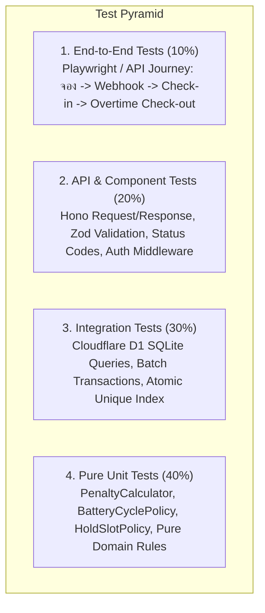

# เอกสารกลยุทธ์การทดสอบ: ระบบจองรถของเล่น (Test Strategy & QA Specification)

> **มาตรฐานอ้างอิง:** Skill `07-testing-qa`  
> **อ้างอิงเอกสารก่อนหน้า:**  
> - Requirements: [`docs/requirements-toy-car-booking.md`](file:///c:/เสรี/docs/requirements-toy-car-booking.md)  
> - System Design: [`docs/system-design-toy-car-booking.md`](file:///c:/เสรี/docs/system-design-toy-car-booking.md)  
> - Code Quality Review: [`docs/code-quality-review-toy-car-booking.md`](file:///c:/เสรี/docs/code-quality-review-toy-car-booking.md)  
> **Test Frameworks:** Vitest + Miniflare (Cloudflare D1 / Workers Emulator) + Supertest / Hono Client

---

## 1. ภาพรวมกลยุทธ์การทดสอบ (Test Pyramid & Approach)

กลยุทธ์การทดสอบถูกจัดโครงสร้างตามแนวคิด **Test Pyramid** เพื่อให้ได้รับความเชื่อมั่นสูงสุดในขณะที่ใช้เวลาในการรันสั้นที่สุด:



---

## 2. ตารางแมปความต้องการสู่การทดสอบ (Requirement Traceability Matrix)

ตารางแสดงความเชื่อมโยงจาก **Requirement (FR)** → **Acceptance Criteria (AC)** → **Test Case ID** และระดับการทดสอบ (Level):

| Req ID | Acceptance Criteria (AC) | Test Case ID | ระดับการทดสอบ | ประเภทการทดสอบ | วัตถุประสงค์การทดสอบ |
|---|---|---|---|---|---|
| **FR-01** | **AC-01.1** กรองรถว่างตามรอบเวลา | `TC-CAT-01` | API Test | Happy Path | เรียก `GET /vehicles?status=AVAILABLE` ได้รายการรถที่พร้อมใช้งาน |
| **FR-01** | **AC-01.2** รถที่กำลังใช้งานต้องขึ้นไม่ว่าง | `TC-CAT-02` | API Test | Boundary | รถสถานะ `IN_USE` หรือ `CHARGING` ต้องไม่ปรากฏใน Slot ว่าง |
| **FR-02** | **AC-01.1** กักสิทธิ์ 5 นาทีและสร้าง QR | `TC-HLD-01` | Integration | Happy Path | `POST /bookings/hold` สร้างแถวสถานะ `HOLD` พร้อม `hold_expires_at` +5 นาที |
| **FR-02** | **AC-01.2** ป้องกันการจองชนกัน (Double-Booking) | `TC-HLD-02` | Integration | Concurrency / Neg | ยิงคำขอ Hold ซ้อนกัน 2 เครื่องพร้อมกันใน Slot เดียวกัน ต้องมี 1 รายการได้ `201` และอีกรายการได้ `409` |
| **FR-02** | **AC-02.2** สิทธิ์ Hold หมดอายุใน 5 นาที | `TC-HLD-03` | Integration | Boundary | จำลองเวลาผ่านไป 5 นาที 01 วินาที สิทธิ์เดิมต้องถูกเคลียร์ และเปิดให้จองใหม่ได้ |
| **FR-03** | **AC-02.1** ชำระเงินสำเร็จ เปลี่ยนเป็น Confirmed | `TC-PAY-01` | API / Webhook | Happy Path | Webhook พร้อม Signature ที่ถูกต้อง อัปเดตสถานะเป็น `CONFIRMED` |
| **FR-03** | Webhook ป้องกัน Replay Attack / Fake | `TC-PAY-02` | API Test | Security / Neg | Webhook ที่ Signature ไม่ถูกต้อง หรือ `transaction_id` ซ้ำ ต้องถูกปฏิเสธ |
| **FR-04** | **AC-03.1** Check-in ปล่อยรถหน้าร้าน | `TC-SES-01` | API Test | Happy Path | พนักงานสแกน QR Ticket ที่ `CONFIRMED` สถานะเปลี่ยนเป็น `ACTIVE` และเริ่มจับเวลา |
| **FR-04** | ห้าม Check-in ตั๋วที่ยังไม่ชำระเงินหรือยกเลิก | `TC-SES-02` | API Test | Negative | สแกนตั๋วสถานะ `HOLD` หรือ `CANCELLED` ต้องได้ `400 Bad Request` |
| **FR-05** | **AC-04.1** แจ้งเตือนเมื่อเหลือเวลา 5 นาที | `TC-TMR-01` | Unit / Worker | Happy Path | ตรวจสอบว่า Cron/Queue Worker ทริกเกอร์แจ้งเตือนเมื่อเวลาถึง `end_time - 5 นาที` |
| **FR-06** | **AC-05.1** คืนรถตรงเวลา คืนมัดจำเต็มจำนวน | `TC-OUT-01` | Unit / API | Happy Path | Check-out ภายใน Grace Period 5 นาที ยอดค่าปรับเป็น 0 บาท คืนมัดจำ 100 บาท |
| **FR-06** | **AC-05.2** คืนรถเกิน Grace Period คิดค่าปรับ | `TC-OUT-02` | Unit / API | Boundary | คืนรถช้า 12 นาที (เกิน 5 นาที = ปรับ 7 นาที) ค่าปรับ 70 บาท หักจากมัดจำ คืนสุทธิ 30 บาท |
| **FR-07** | **BR-05** บังคับชาร์จแบตเตอรี่เมื่อครบ 3 รอบ | `TC-FLT-01` | Unit / Int | Boundary | หลัง Check-out รอบที่ 3 สถานะรถต้องเปลี่ยนเป็น `CHARGING` ทันที |

---

## 3. การทดสอบค่าขอบเขตและกรณีปฏิเสธ (Boundary Value Analysis & Negative Tests)

### 3.1 การวิเคราะห์ค่าขอบเขต (Boundary Value Analysis - BVA)

#### กรณีที่ 1: การคิดค่าปรับตามเวลาคืนรถ (Grace Period 5 นาที)
* **เกณฑ์:** ผ่อนผัน 5 นาที (300 วินาที) ค่าปรับ 10 บาท/นาทีส่วนเกิน (ปัดเศษวินาทีขึ้นเป็นนาทีเต็ม)
* **Test Cases:**
  * `BVA-PEN-01 (ตรงเวลาพอดี):` คืนช้า 0 วินาที → ปรับ **0 บาท** (มัดจำคืน 100 บาท)
  * `BVA-PEN-02 (ปลาย Grace Period):` คืนช้า 4 นาที 59 วินาที → ปรับ **0 บาท** (มัดจำคืน 100 บาท)
  * `BVA-PEN-03 (ขอบ Grace Period พอดี):` คืนช้า 5 นาที 00 วินาที → ปรับ **0 บาท** (มัดจำคืน 100 บาท)
  * `BVA-PEN-04 (เกิน Grace Period 1 วินาที):` คืนช้า 5 นาที 01 วินาที → ส่วนเกิน 1 วินาที ปัดเป็น 1 นาที → ปรับ **10 บาท** (มัดจำคืน 90 บาท)
  * `BVA-PEN-05 (เกิน Grace Period 1 นาทีเต็ม):` คืนช้า 6 นาที 00 วินาที → ส่วนเกิน 1 นาที → ปรับ **10 บาท** (มัดจำคืน 90 บาท)
  * `BVA-PEN-06 (ค่าปรับเกินเงินมัดจำ):` คืนช้า 20 นาที (ส่วนเกิน 15 นาที) → ค่าปรับ 150 บาท → มัดจำ 100 บาทถูกยึดทั้งหมด + **ต้องจ่ายเพิ่ม 50 บาท**

#### กรณีที่ 2: วงรอบแบตเตอรี่ (Battery Cycle Limit)
* **เกณฑ์:** ให้บริการได้สูงสุด 3 รอบสะสม
* **Test Cases:**
  * `BVA-BAT-01:` เล่นจบรอบที่ 1 → `cycle_count = 1`, สถานะ = `AVAILABLE`
  * `BVA-BAT-02:` เล่นจบรอบที่ 2 → `cycle_count = 2`, สถานะ = `AVAILABLE`
  * `BVA-BAT-03:` เล่นจบรอบที่ 3 → `cycle_count = 3`, สถานะเปลี่ยนเป็น `CHARGING` ทันที (ห้ามจอง)
  * `BVA-BAT-04:` พนักงานกดชาร์จเสร็จ → `cycle_count = 0`, สถานะกลับเป็น `AVAILABLE`

#### กรณีที่ 3: เกณฑ์น้ำหนักเด็ก (Weight Limit)
* **เกณฑ์:** รถรุ่นเล็กรับน้ำหนักได้สูงสุด 25 กิโลกรัม
* **Test Cases:**
  * `BVA-WGT-01:` ระบุน้ำหนัก 24.9 กก. → ผ่าน
  * `BVA-WGT-02:` ระบุน้ำหนัก 25.0 กก. → ผ่าน
  * `BVA-WGT-03:` ระบุน้ำหนัก 25.1 กก. → ปฏิเสธ (`400 Validation Error: น้ำหนักเกินเกณฑ์`)

---

### 3.2 ชุดการทดสอบกรณีข้อผิดพลาด (Negative Test Scenarios)

1. **`NEG-AUTH-01 (Unauthorized Staff Route):`**
   * ยิง `POST /rental-sessions/checkin` โดยไม่มี Header `Authorization`
   * **ผลลัพธ์ที่คาดหวัง:** `401 Unauthorized` พร้อม Error RFC 9457
2. **`NEG-AUTH-02 (Expired JWT Token):`**
   * ยิงคำขอโดยใช้ JWT Token ที่หมดอายุแล้ว
   * **ผลลัพธ์ที่คาดหวัง:** `401 Unauthorized: Token has expired`
3. **`NEG-VAL-01 (Malformed Thai Phone Number):`**
   * กรอกเบอร์ `0123456789` (ไม่ใช่เบอร์มือถือ) หรือ `081-12345` (สั้นเกินไป)
   * **ผลลัพธ์ที่คาดหวัง:** `400 Bad Request` พร้อมชี้เป้าฟิลด์ `customer_phone`
4. **`NEG-CONCUR-01 (Simultaneous Double-Booking):`**
   * ส่งคำขอ Hold รถคันเดียวกัน เวลาเดียวกัน พร้อมกัน 10 Threads ในเสี้ยววินาทีเดียวกัน
   * **ผลลัพธ์ที่คาดหวัง:** มีเพียง 1 คำขอที่ได้ HTTP 201 ส่วนอีก 9 คำขอได้ HTTP 409 Conflict
5. **`NEG-PAY-01 (Tampered Webhook Signature):`**
   * ปลอมแปลงยอดเงินใน Webhook แต่ใช้ HMAC Secret ที่ไม่ถูกต้อง
   * **ผลลัพธ์ที่คาดหวัง:** `401 Unauthorized: Invalid Webhook Signature`

---

## 4. ตัวอย่างการเขียนชุดทดสอบ (Concrete Test Implementation Example)

### ตัวอย่าง Unit Test สำหรับ `PenaltyCalculator` (Pure Domain Test)

```typescript
import { describe, it, expect } from 'vitest';
import { PenaltyCalculator } from '../src/modules/session/domain/PenaltyCalculator';

describe('PenaltyCalculator (Domain Unit Tests)', () => {
  const baseScheduledEnd = new Date('2026-09-30T14:30:00.000Z');

  it('คืนรถตรงเวลาเป๊ะ: ค่าปรับต้องเป็น 0 บาท', () => {
    const returnTime = new Date('2026-09-30T14:30:00.000Z');
    const result = PenaltyCalculator.calculate(baseScheduledEnd, returnTime);

    expect(result.billableOvertimeMinutes).toBe(0);
    expect(result.penaltyCents).toBe(0);
  });

  it('คืนรถช้า 4 นาที 59 วินาที (ยังอยู่ใน Grace Period): ค่าปรับเป็น 0 บาท', () => {
    const returnTime = new Date('2026-09-30T14:34:59.000Z');
    const result = PenaltyCalculator.calculate(baseScheduledEnd, returnTime);

    expect(result.billableOvertimeMinutes).toBe(0);
    expect(result.penaltyCents).toBe(0);
  });

  it('คืนรถช้า 5 นาที 01 วินาที (เกินมา 1 วินาที): ปัดเป็น 1 นาที คิดค่าปรับ 10 บาท (1,000 สตางค์)', () => {
    const returnTime = new Date('2026-09-30T14:35:01.000Z');
    const result = PenaltyCalculator.calculate(baseScheduledEnd, returnTime);

    expect(result.billableOvertimeMinutes).toBe(1);
    expect(result.penaltyCents).toBe(1000);
  });

  it('คืนรถช้า 12 นาที (เกิน Grace Period 7 นาที): คิดค่าปรับ 70 บาท (7,000 สตางค์)', () => {
    const returnTime = new Date('2026-09-30T14:42:00.000Z');
    const result = PenaltyCalculator.calculate(baseScheduledEnd, returnTime);

    expect(result.billableOvertimeMinutes).toBe(7);
    expect(result.penaltyCents).toBe(7000);
  });
});
```

---

## 5. การจัดการข้อมูลทดสอบ (Test Data Management & Isolation)

* **Isolated Local SQLite Database:** ใช้ `@cloudflare/vitest-pool-workers` หรือ `miniflare` จำลอง Cloudflare D1 ในหน่วยความจำ โดยรัน Script Migration สร้างตารางใหม่สะอาดก่อนเริ่มแต่ละ Test Suite
* **Test Factories:** สร้าง Helper สำหรับสร้าง Dummy Entity ที่ถูกต้องตามมาตรฐาน:
  * `createMockVehicle({ code: 'CAR-01', status: 'AVAILABLE' })`
  * `createMockBooking({ vehicleId, status: 'CONFIRMED' })`
* **Time Travel Mocking:** ใช้ `vi.useFakeTimers()` ของ Vitest เพื่อจำลองการเลื่อนเวลาของระบบโดยไม่ต้องสั่ง `sleep()` ในโค้ดจริง

---

## 6. แผนการทดสอบเพื่อป้องกันข้อผิดพลาดซ้ำ (Regression Test Plan)

* **Automated CI Regression Pipeline:** ทุก Pull Request และ Commit เข้าสู่ `main` ต้องรันชุดคำสั่ง:
  ```bash
  npm run lint && npm run test:unit && npm run test:integration
  ```
* **Critical Path Regression Suite:** ชุดทดสอบเส้นทางวิกฤต 5 เส้นทางที่ห้ามพังเด็ดขาด:
  1. กักสิทธิ์จองรอบเวลา และการคืนสิทธิ์เมื่อหมดอายุ 5 นาที
  2. การรับ Webhook ยืนยันเงิน และการสร้าง QR Ticket
  3. การสแกน Check-in ปล่อยรถ
  4. การคำนวณค่าปรับ Overtime ในช่วงรอยต่อ Grace Period
  5. การตัดรอบแบตเตอรี่เข้าสู่โหมดชาร์จเมื่อเล่นครบ 3 ครั้ง

---

## 7. ประตูด่านคุณภาพก่อนปล่อยระบบ (Quality Gates before Release)

| เกณฑ์วัดคุณภาพ (Quality Gate) | เป้าหมายขั้นต่ำ (Threshold) | เครื่องมือตรวจสอบ |
|---|---|---|
| **Unit Test Code Coverage** | $\ge 85\%$ (Branch & Statement) | Vitest Coverage (v8) |
| **Critical Domain Rules Coverage** | **$100\%$** (Penalty & Battery rules) | Vitest |
| **Integration & Concurrency Tests** | Pass $100\%$ (ห้ามมี Flaky Tests) | Miniflare Worker Pool |
| **Linting & Type Safety** | 0 Errors, 0 Warnings (`strict: true`) | ESLint + TypeScript Compiler |
| **Security Audit** | 0 High/Critical Vulnerabilities | `npm audit` / Snyk |
| **OpenAPI Contract Drift** | Pass $100\%$ | Dredd / Prism Mock Validator |

---

## 8. ขั้นตอนถัดไป (Next Steps)
เอกสาร Test Strategy นี้พร้อมสำหรับส่งมอบไปยัง:
1. การเริ่มเขียน Automated Tests ในโฟลเดอร์ `tests/` ควบคู่กับการพัฒนา Source Code
2. **`08-debugging-refactoring`**: แนวทางแก้บั๊กและจัดการ Technical Debt หากพบข้อผิดพลาดระหว่างรันการทดสอบ
3. **`09-owasp-security`**: ตรวจสอบช่องโหว่ความปลอดภัยระดับ Application และ API
